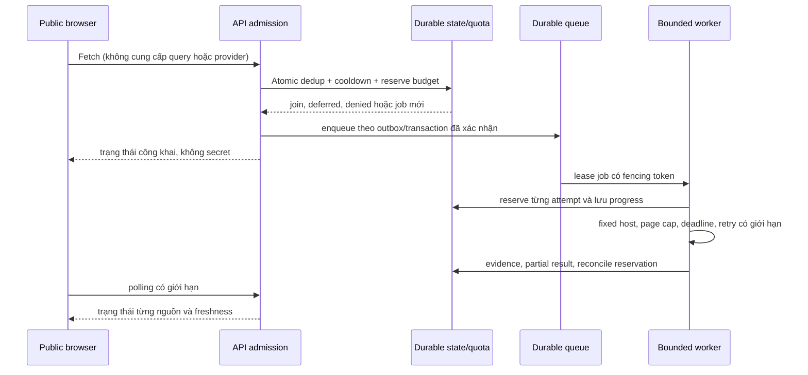

# D5 — Blueprint tích hợp live bốn nguồn

**Trạng thái:** thiết kế, không phải lệnh bật live. Rà soát 11/11/2026. Bốn nguồn duy nhất trong Phase 1: Wikimedia Pageviews top-per-country, Google SERP qua SerpApi, Bing SERP qua SerpApi, YouTube Data API v3. Public Fetch hiện chỉ synthetic/local/test; Vercel hiện read-only. D5 chỉ bắt đầu sau chỉ thị riêng; không có provider, credential, quota thực hay chi phí nào được chứng minh bởi D4.

## 1. Ranh giới và nghiệm thu từng nguồn

| Source / contract | Access và credential | Endpoint, paging, quota/cost | Scope, quyền và freshness | Bằng chứng cần thu khi được duyệt |
|---|---|---|---|---|
| `wikimedia_pageviews_top_per_country` / Wikimedia AQS | Phê duyệt use case, user-agent và hạn mức; không giả định tài khoản/credential là cần thiết | Endpoint top-per-country hiện tại; kiểm tra date availability, retry/rate và policy; lưu sample top-list bị censored | Country US của pageviews tổng hợp; kiểm tra delay, license, attribution và retention | Live network test theo ngày, response schema, rate/partial failure, provenance, monitoring và chi phí hạ tầng |
| `google_web_serp` / `serpapi_google` | Phê duyệt SerpApi và use case; `SERPAPI_API_KEY` chỉ backend secret | `https://serpapi.com/search.json`, engine `google`, `start` offset; cùng quota account với Bing. Kiểm tra plan giá/throughput và result limit | `gl=us`, `hl=en` chỉ localization; không là search volume hay US audience. Review copyright, snippet, retention/cache/attribution | Live test độc lập fixed query, nhiều trang, rate và quota, freshness/cache, lỗi partial, evidence và monitoring |
| `bing_web_serp` / `serpapi_bing` | Cùng gate và secret backend như Google | Cùng endpoint với engine `bing`, `first` bắt đầu 1; next offset theo metadata được kiểm tra, không giả định bước cố định; cùng pool SerpApi | `mkt=en-US` là market routing; không chứng minh nơi cư trú hay search volume. Review quyền và retention riêng | Test độc lập Bing pagination, rate, partial, scope, freshness, provenance, monitoring và chi phí |
| `youtube_video_search` / YouTube Data API v3 | Phê duyệt project, quota, Developer Policies và `YOUTUBE_API_KEY` backend | `search.list`, page token bind query/filter; xác minh quota thực và rate, không mặc định quota tài liệu là quota project | `regionCode=US` là khả dụng theo vùng, `relevanceLanguage=en` là relevance; review derived metrics, display, retention/deletion | Test live từng query/page, quota/rate, partial, timestamps, evidence và monitoring |

Mỗi hàng cần checklist có bằng chứng: (1) access/use case phê duyệt; (2) secret server được cấu hình nếu cần; (3) endpoint và schema xác minh; (4) quota, throughput, giá và budget xác nhận trên tài khoản; (5) allowed use; (6) retention/deletion/attribution; (7) live network test có kiểm soát; (8) pagination và result cap; (9) rate, Retry-After và bounded retry; (10) diễn giải US scope; (11) freshness/cache; (12) lỗi từng phần; (13) evidence/provenance; (14) metrics/alerts và kill switch. Mọi mục chưa có bằng chứng là **chưa đạt**. `LIVE_CONFIGURED` không đồng nghĩa `LIVE_VERIFIED`.

Nguồn tham khảo: [Wikimedia Pageviews](https://wikitech.wikimedia.org/wiki/Analytics/AQS/Pageviews), [SerpApi Google](https://serpapi.com/search-api), [SerpApi Bing](https://serpapi.com/bing-search-api), [SerpApi errors](https://serpapi.com/api-status-and-error-codes), [SerpApi pricing](https://serpapi.com/pricing), [SerpApi legal](https://serpapi.com/legal), [YouTube search.list](https://developers.google.com/youtube/data/reference/rest/v3/search/list), [YouTube policies](https://developers.google.com/youtube/terms/developer-policies). Provider có thể thay đổi; kiểm tra lại trước khi cấu hình.

## 2. Execution boundary và admission

Admission phải chạy trên backend phù hợp với worker, không chỉ bật POST trên Vercel. Database/queue cụ thể chưa được chọn. Atomic check-and-reserve gồm global concurrency, per-provider quota, shared SerpApi budget, cost ceiling, cooldown, idempotency và dedup trên nhiều host; bảo vệ direct clients, bots, nhiều IP/process, restart và retry storm. Origin/Host là tín hiệu browser, không phải xác thực. Queue cần durable state, lease expiry, fencing, outbox hoặc cơ chế tương đương, idempotent writes, bounded retries và recovery. Test crash giữa reserve, enqueue, request và commit; tránh chi hai lần hoặc mất job. D4 pool process-local chỉ là mô phỏng, không được dùng làm bảo đảm production.

Không cho client thay plan, query, URL, source, provider, quota hoặc permissions. Server quyết định source allowlist, lịch và ngân sách; người dùng được join job đã có, nhận cache còn quyền hoặc deferred khi hết quota. Không trả provider secrets hay request URL chứa key. SerpApi tài liệu hóa `api_key` là parameter: live design phải bảo vệ URL khỏi access logs, tracing, proxy, errors và telemetry, xác nhận cơ chế credential trước activation.

## 3. Source orchestration và dữ liệu

- Wikimedia là broad top-list theo ngày với censoring; ba nguồn query là mẫu theo 14 seeds, không chứng minh toàn bộ US. Giữ `demo-us-en` v1 và fingerprint cho demo; thay plan cần migration và đánh giá riêng.
- Adapter chỉ gửi host cố định, allowlist tham số và bounded body; không follow provider-supplied next URL. Bing trích `first` an toàn từ metadata vì ví dụ provider cho offset biến thiên; Google `start` theo trang. `tbs=qdr:w` và Bing `filters` chưa được dùng cho tới khi ngữ nghĩa, thời gian và provider contract được xác minh cho use case.
- Lưu per-source status, sample scope, query, filter, timestamp, cache provenance, page/limit, reject count, metric descriptor và evidence. Canonical URL dedup giữ mọi query evidence. Source-level metrics không cộng trực tiếp; SERP rank không phải volume hoặc sales.
- Cache bền có TTL và deletion theo quyền từng provider; stale chỉ trả khi còn quyền và có tuổi dữ liệu. Khi quota cạn, hiển thị deferred hoặc stale có lý do; không rotate key hay bỏ qua hạn mức.
- Extraction, taxonomy, baseline, detection và explain tách version. Không ép keyword xuất hiện ở bốn nguồn. UI nêu coverage và US evidence, không hứa đại diện toàn bộ trend.

## 4. Thứ tự thực thi D5 đề xuất

1. Chốt provider agreements, chi phí, quyền sử dụng và retention; ghi người duyệt, thời hạn và scope.
2. Thiết kế môi trường backend, durable store/queue, network egress, secret management và atomic reservation; threat-model, load và chaos test offline trước.
3. Kết nối từng adapter sau khi được bật riêng; contract tests, live smoke nhỏ có ngân sách được duyệt, pagination và error evidence; không chuyển trạng thái nguồn khác.
4. Thực hiện orchestration, shared cache, source-level progress và partial results; kiểm tra restart, duplicate, multi-process và quota reconciliation.
5. Thêm extraction/detection với baseline đủ dữ liệu, explainability, UI và data governance; UAT có nguồn và hạn chế rõ.
6. Chuyển D6 sau review bảo mật/chi phí và bằng chứng; D6 xác minh end-to-end độc lập. Live Public Fetch vẫn disabled cho tới quyết định riêng.

## 5. Open decisions và rollback

Chưa chọn backend runtime, store, queue, SLO, TTL, cost ceiling, WAF/bot controls, policy derived metrics, mức support và owner approval. Với sự cố: đóng feature flag/admission, ngừng cấp lease và request mới, giữ trạng thái partial; revoke/rotate credential nếu cần, tuân theo deletion obligations, điều tra audit log đã redacted. Không tự retry vô hạn hoặc thay key để né quota. Sau rollback cần kiểm tra tính nhất quán quota và job trước khi xem xét bật lại.
