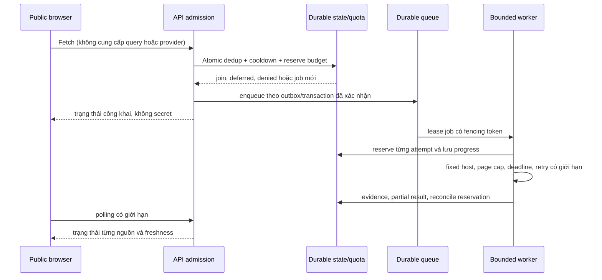

# D5 — Blueprint tích hợp live bốn nguồn

**Trạng thái:** D5 đang thực hiện; không phải lệnh bật live. Điều chỉnh roadmap 11/11/2026: D5 xây dựng và kiểm chứng offline hạ tầng live-capable; D6 thiết lập tài khoản thuộc tổ chức, quản lý credential và kích hoạt live; D7 nghiệm thu live cuối. Không có D3C. Bốn nguồn: Wikimedia Pageviews top-per-country, Google SERP qua SerpApi, Bing SERP qua SerpApi, YouTube Data API v3. Public Fetch hiện chỉ synthetic/local/test; Vercel hiện read-only. D4 không chứng minh provider, credential, quota thực hay chi phí.

## 1. Ranh giới và nghiệm thu từng nguồn

| Source / contract | Access và credential | Endpoint, paging, quota/cost | Scope, quyền và freshness | Bằng chứng cần thu khi được duyệt |
|---|---|---|---|---|
| `wikimedia_pageviews_top_per_country` / Wikimedia AQS | Phê duyệt use case, user-agent và hạn mức; không giả định tài khoản/credential là cần thiết | Endpoint top-per-country hiện tại; kiểm tra date availability, retry/rate và policy; lưu sample top-list bị censored | Country US của pageviews tổng hợp; kiểm tra delay, license, attribution và retention | Live network test theo ngày, response schema, rate/partial failure, provenance, monitoring và chi phí hạ tầng |
| `google_web_serp` / `serpapi_google` | Phê duyệt SerpApi và use case; `SERPAPI_API_KEY` chỉ backend secret | `https://serpapi.com/search.json`, engine `google`, `start` offset; cùng quota account với Bing. Kiểm tra plan giá/throughput và result limit | `gl=us`, `hl=en` chỉ localization; không là search volume hay US audience. Review copyright, snippet, retention/cache/attribution | Live test độc lập fixed query, nhiều trang, rate và quota, freshness/cache, lỗi partial, evidence và monitoring |
| `bing_web_serp` / `serpapi_bing` | Cùng gate và secret backend như Google | Cùng endpoint với engine `bing`, `first` bắt đầu 1; next offset theo metadata được kiểm tra, không giả định bước cố định; cùng pool SerpApi | `mkt=en-US` là market routing; không chứng minh nơi cư trú hay search volume. Review quyền và retention riêng | Test độc lập Bing pagination, rate, partial, scope, freshness, provenance, monitoring và chi phí |
| `youtube_video_search` / YouTube Data API v3 | Phê duyệt project, quota, Developer Policies và `YOUTUBE_API_KEY` backend | `search.list`, page token bind query/filter; xác minh quota thực và rate, không mặc định quota tài liệu là quota project | `regionCode=US` là khả dụng theo vùng, `relevanceLanguage=en` là relevance; review derived metrics, display, retention/deletion | Test live từng query/page, quota/rate, partial, timestamps, evidence và monitoring |

Mỗi hàng cần checklist có bằng chứng: (1) access/use case phê duyệt; (2) secret server được cấu hình nếu cần; (3) endpoint và schema xác minh; (4) quota, throughput, giá và budget xác nhận trên tài khoản; (5) allowed use; (6) retention/deletion/attribution; (7) live network test có kiểm soát; (8) pagination và result cap; (9) rate, Retry-After và bounded retry; (10) diễn giải US scope; (11) freshness/cache; (12) lỗi từng phần; (13) evidence/provenance; (14) metrics/alerts và kill switch. Mọi mục chưa có bằng chứng là **chưa đạt**. `LIVE_CONFIGURED` không đồng nghĩa `LIVE_VERIFIED`.

Nguồn tham khảo: [Wikimedia Pageviews](https://wikitech.wikimedia.org/wiki/Analytics/AQS/Pageviews), [SerpApi Google](https://serpapi.com/search-api), [SerpApi Bing](https://serpapi.com/bing-search-api), [SerpApi errors](https://serpapi.com/api-status-and-error-codes), [SerpApi pricing](https://serpapi.com/pricing), [SerpApi legal](https://serpapi.com/legal), [YouTube search.list](https://developers.google.com/youtube/data/reference/rest/v3/search/list), [YouTube policies](https://developers.google.com/youtube/terms/developer-policies). Provider có thể thay đổi; kiểm tra lại trước khi cấu hình.

## 2. Execution boundary và admission

Admission phải chạy trên backend phù hợp với worker, không chỉ bật POST trên Vercel. Giữ Firebase/Firestore hiện có và sử dụng Storage Port; không migration database trong D5/D6 khi chưa có quyết định riêng. Phương án worker/queue và khả năng Firestore đáp ứng giao dịch phân tán còn cần chứng minh. Atomic check-and-reserve gồm global concurrency, per-provider quota, shared SerpApi budget, cost ceiling, cooldown, idempotency và dedup trên nhiều host; bảo vệ direct clients, bots, nhiều IP/process, restart và retry storm. Origin/Host là tín hiệu browser, không phải xác thực. Queue cần durable state, lease expiry, fencing, outbox hoặc cơ chế tương đương, idempotent writes, bounded retries và recovery. Test crash giữa reserve, enqueue, request và commit; tránh chi hai lần hoặc mất job. D4 pool process-local chỉ là mô phỏng, không được dùng làm bảo đảm production.

Không cho client thay plan, query, URL, source, provider, quota hoặc permissions. Server quyết định source allowlist, lịch và ngân sách; người dùng được join job đã có, nhận cache còn quyền hoặc deferred khi hết quota. Không trả provider secrets hay request URL chứa key. SerpApi tài liệu hóa `api_key` là parameter: live design phải bảo vệ URL khỏi access logs, tracing, proxy, errors và telemetry, xác nhận cơ chế credential trước activation.

## 3. Source orchestration và dữ liệu

- Wikimedia là broad top-list theo ngày với censoring; ba nguồn query là mẫu theo 14 seeds, không chứng minh toàn bộ US. Giữ `demo-us-en` v1 và fingerprint cho demo; thay plan cần migration và đánh giá riêng.
- Adapter chỉ gửi host cố định, allowlist tham số và bounded body; không follow provider-supplied next URL. Bing trích `first` an toàn từ metadata vì ví dụ provider cho offset biến thiên; Google `start` theo trang. `tbs=qdr:w` và Bing `filters` chưa được dùng cho tới khi ngữ nghĩa, thời gian và provider contract được xác minh cho use case.
- Lưu per-source status, sample scope, query, filter, timestamp, cache provenance, page/limit, reject count, metric descriptor và evidence. Canonical URL dedup giữ mọi query evidence. Source-level metrics không cộng trực tiếp; SERP rank không phải volume hoặc sales.
- Cache bền có TTL và deletion theo quyền từng provider; stale chỉ trả khi còn quyền và có tuổi dữ liệu. Khi quota cạn, hiển thị deferred hoặc stale có lý do; không rotate key hay bỏ qua hạn mức.
- Extraction, taxonomy, baseline, detection và explain tách version. Không ép keyword xuất hiện ở bốn nguồn. UI nêu coverage và US evidence, không hứa đại diện toàn bộ trend.

## 4. Thứ tự thực thi D5 đề xuất

1. Xây dựng live-capable adapters và CredentialProvider backend chung; không cấu hình secrets hay gửi live requests.
2. Hoàn thiện Storage Port, distributed admission, quota, durable queue/cache và kiểm chứng offline, bao gồm crash, duplicate, multi-process và reconciliation.
3. Tích hợp orchestration, extraction/detection, evidence và dashboard; chạy full regression offline.
4. Bàn giao [kế hoạch D6](D6_PROVIDER_ACCOUNT_CREDENTIAL_AND_LIVE_ACTIVATION_PLAN.md): tổ chức sở hữu provider accounts, phê duyệt và cấu hình secrets, admin riêng, kích hoạt và xác minh từng nguồn.
5. D7 thực hiện final live E2E, security, data quality, performance và UAT. Public live Fetch disabled cho tới quyết định riêng.

### Revised D5 acceptance matrix

| Gate | Bằng chứng bắt buộc | Trạng thái hiện tại |
|---|---|---|
| Live-capable code | Bốn adapters có transport giới hạn và contract tests offline | OPEN: ba adapter vẫn chỉ MockTransport |
| Credential boundary | Provider dùng CredentialProvider backend; không secret trong browser | OPEN: protocol chung đã tạo, chưa hoàn tất wiring và review |
| Storage abstraction | Business logic dùng port, Firestore ở adapter | OPEN: port hiện có chưa bao phủ đầy đủ D5 |
| Distributed Fetch | Multi-process admission, durable lease/fencing, recovery được kiểm chứng | OPEN: có model qua Storage Port, fake Firestore adapter và test multi-process một máy; chưa nối worker/deployment hoặc xác minh multi-host |
| Quota/cache/queue | Atomic shared quota/cost, durable cache/queue và crash tests | OPEN: ledger/queue/lease/cache có model offline; proactive deletion, worker thật, quota reconciliation và deployment chưa hoàn tất |
| Keyword discovery | Extraction, source-scoped trend, evidence và kiểm thử | OPEN: module ban đầu chưa tích hợp |
| Dashboard integration | Workflow offline, status, evidence, accessibility và regression | OPEN |
| Offline integration tests | End-to-end fixture không gọi provider/cloud | OPEN |
| Full regression | Readiness script và Golden pass | OPEN cho thay đổi D5 hiện tại |
| D6 onboarding blueprint | Ownership, secrets, controls, approval và rollout có thể review | OPEN cho đến khi review hoàn tất |

Chỉ sau khi toàn bộ gate trên PASS mới dùng `D5_LIVE_CAPABLE_OFFLINE_VERIFIED`; khi đó vẫn ghi `D6_PROVIDER_ONBOARDING_PENDING` và `LIVE_ACTIVATION_NOT_YET_ACCEPTED`. Không yêu cầu bốn nguồn `LIVE_VERIFIED` cho D5.

### Demo-first presentation checklist

`DEMO_READY_FOR_PRESENTATION` là checklist riêng, không đồng nghĩa `FOUR_SOURCE_LIVE_VERIFIED` hoặc hoàn thành các gate D5. Không cần tài khoản công ty, credential cá nhân hoặc Firebase cá nhân để chạy demo. Wikimedia live chỉ dùng sau phép và kiểm chứng riêng; trong khi thiếu credentials, dữ liệu còn lại phải ghi `SYNTHETIC`. Từng nguồn cần phân biệt provenance `LIVE`, `CACHED`, `SYNTHETIC`; `INSUFFICIENT_EVIDENCE` là trạng thái đánh giá, không phải nguồn dữ liệu. Không gán lại cached hay synthetic thành live.

| Kiểm tra trình diễn | Trạng thái |
|---|---|
| Khởi động local, loopback, storage tạm, không yêu cầu secret/account | `bash demo.sh`; kiểm thử API offline và trình duyệt với launcher thật |
| Fetch một nút, kết quả và trạng thái rõ ràng | PASS thủ công qua trình duyệt local cho Wikimedia và ba nhánh synthetic bổ sung; trạng thái tổng PARTIAL |
| Fixture Google/Bing/YouTube gắn nhãn rõ và tích hợp dashboard | PASS phạm vi demo local: MockTransport, mỗi nguồn một query, không có baseline; lọc chỉ áp dụng trên tối đa 30 mẫu |
| Phân biệt LIVE/CACHED/SYNTHETIC và INSUFFICIENT_EVIDENCE xuyên API, thuật toán, UI | OPEN |
| Light/dark, VI/EN, responsive và regression | Offline regression PASS; cần thêm kiểm thử tự động toàn flow demo bốn nguồn và rà soát trình diễn |
| Dữ liệu không bị nhận nhầm là live; phân biệt presentation với live acceptance | Các nguồn fixture ghi SYNTHETIC; vẫn cần đánh giá trạng thái LIVE/CACHED trong flow tương lai |

Storage tạm là lựa chọn demo local, không chứng minh durable, distributed admission hay an toàn public production. D6 xử lý account/secret của công ty và live activation; D7 nghiệm thu live cuối.

## 5. Open decisions và rollback

Chưa chọn backend runtime, store, queue, SLO, TTL, cost ceiling, WAF/bot controls, policy derived metrics, mức support và owner approval. Với sự cố: đóng feature flag/admission, ngừng cấp lease và request mới, giữ trạng thái partial; revoke/rotate credential nếu cần, tuân theo deletion obligations, điều tra audit log đã redacted. Không tự retry vô hạn hoặc thay key để né quota. Sau rollback cần kiểm tra tính nhất quán quota và job trước khi xem xét bật lại.
