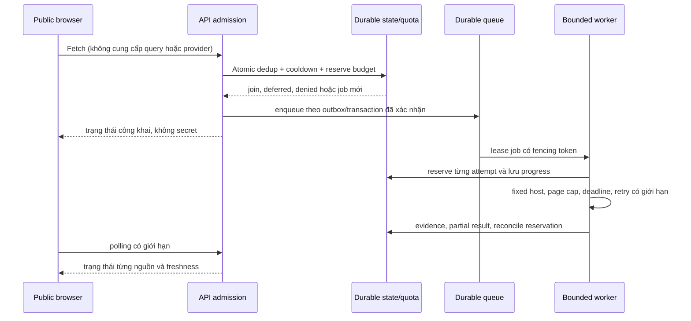

# D5 — Blueprint tích hợp live bốn nguồn

**Trạng thái (12/11/2026): `DEMO_ACCEPTANCE=100%` cho demo local synthetic; `PRODUCTION_MULTI_HOST_ACCEPTANCE=BLOCKED`; `D5_PRODUCTION_READINESS=PARTIAL`; `FOUR_SOURCE_LIVE_VERIFIED=NOT_ACCEPTED`.** Bối cảnh mới: TrendScout là dự án cá nhân để trình bày demo; các tài khoản phát triển hiện có thuộc cá nhân, công ty chưa cấp tài khoản/hạ tầng. Không dùng các tài nguyên cá nhân đó làm điều kiện hay bằng chứng production. Không có D3C. D5 ưu tiên demo và hoàn thiện code/offline tests; D6 tích hợp tài khoản/credentials do công ty cấp và quy trình kích hoạt live; D7 nghiệm thu multi-host production, live E2E và UAT. Bốn nguồn: Wikimedia Pageviews top-per-country, Google SERP qua SerpApi, Bing SERP qua SerpApi, YouTube Data API v3. Public live Fetch vẫn disabled; Vercel hiện read-only.

## Acceptance tracks — DEMO-FIRST, PRODUCTION-LATER

Hai acceptance độc lập; PASS của demo không phải production readiness. Demo chạy local với fixture synthetic, không cần tài khoản công ty, credential cá nhân, Firebase/Firestore hay dịch vụ trả phí. Không gửi live provider requests.

| Track / gate | Acceptance evidence | Status |
|---|---|---|
| `DEMO_ACCEPTANCE` — dashboard, UI/UX, one-click Fetch, four synthetic sources, keyword discovery, regression và demo-scope security | Local loopback launcher/API, một nút Fetch và polling, bốn nguồn `SYNTHETIC`, keyword search/filter/detail/evidence, responsive/theme/locale/keyboard, browser E2E, regression/Golden, không login UI hoặc browser credentials, Fetch inputs/server policy bounded | **PASS — 100%**; local synthetic presentation only |
| `PRODUCTION_MULTI_HOST_ACCEPTANCE` — shared backing store, hai host độc lập, supervisor, distributed quota và crash recovery | Cùng non-production backing store thực, hai host instance độc lập cùng chạy, quota/queue cạnh tranh, supervisor restart sau crash, recovery evidence và review quyền/chi phí | **BLOCKED**; chưa có company-owned hạ tầng được cấp/duyệt và chưa chạy hai host thực. Same-host tests không thay thế gate này |
| `D5_PRODUCTION_READINESS` | Production backing, distributed controls, retention/reconciliation, deployment/supervision và independent security review được xác minh | **PARTIAL**; offline implementations/tests không chứng minh deployment behavior |
| `FOUR_SOURCE_LIVE_VERIFIED` | Mỗi provider có approval, account/credential phù hợp, quota/cost review và dated live evidence | **NOT_ACCEPTED**; toàn bộ live activation disabled; chuyển sang D6/D7 |

Tỷ lệ `DEMO_ACCEPTANCE=100%` chỉ áp dụng checklist demo ở dưới. Không gọi D5 production-ready, `D5_LIVE_CAPABLE_OFFLINE_VERIFIED` hoặc bốn nguồn LIVE_VERIFIED dựa trên tỷ lệ này.

## 1. Ranh giới và nghiệm thu từng nguồn

| Source / contract | Access và credential | Endpoint, paging, quota/cost | Scope, quyền và freshness | Bằng chứng cần thu khi được duyệt |
|---|---|---|---|---|
| `wikimedia_pageviews_top_per_country` / Wikimedia AQS | Phê duyệt use case, user-agent và hạn mức; không giả định tài khoản/credential là cần thiết | Endpoint top-per-country hiện tại; kiểm tra date availability, retry/rate và policy; lưu sample top-list bị censored | Country US của pageviews tổng hợp; kiểm tra delay, license, attribution và retention | Live network test theo ngày, response schema, rate/partial failure, provenance, monitoring và chi phí hạ tầng |
| `google_web_serp` / `serpapi_google` | Phê duyệt SerpApi và use case; `SERPAPI_API_KEY` chỉ backend secret | `https://serpapi.com/search.json`, engine `google`, `start` offset; cùng quota account với Bing. Kiểm tra plan giá/throughput và result limit | `gl=us`, `hl=en` chỉ localization; không là search volume hay US audience. Review copyright, snippet, retention/cache/attribution | Live test độc lập fixed query, nhiều trang, rate và quota, freshness/cache, lỗi partial, evidence và monitoring |
| `bing_web_serp` / `serpapi_bing` | Cùng gate và secret backend như Google | Cùng endpoint với engine `bing`, `first` bắt đầu 1; next offset theo metadata được kiểm tra, không giả định bước cố định; cùng pool SerpApi | `mkt=en-US` là market routing; không chứng minh nơi cư trú hay search volume. Review quyền và retention riêng | Test độc lập Bing pagination, rate, partial, scope, freshness, provenance, monitoring và chi phí |
| `youtube_video_search` / YouTube Data API v3 | Phê duyệt project, quota, Developer Policies và `YOUTUBE_API_KEY` backend | `search.list`, page token bind query/filter; xác minh quota thực và rate, không mặc định quota tài liệu là quota project | `regionCode=US` là khả dụng theo vùng, `relevanceLanguage=en` là relevance; review derived metrics, display, retention/deletion | Test live từng query/page, quota/rate, partial, timestamps, evidence và monitoring |

Mỗi hàng cần checklist có bằng chứng: (1) access/use case phê duyệt; (2) secret server được cấu hình nếu cần; (3) endpoint và schema xác minh; (4) quota, throughput, giá và budget xác nhận trên tài khoản; (5) allowed use; (6) retention/deletion/attribution; (7) live network test có kiểm soát; (8) pagination và result cap; (9) rate, Retry-After và bounded retry; (10) diễn giải US scope; (11) freshness/cache; (12) lỗi từng phần; (13) evidence/provenance; (14) metrics/alerts và kill switch. Mọi mục chưa có bằng chứng là **chưa đạt**. `LIVE_CONFIGURED` không đồng nghĩa `LIVE_VERIFIED`.

Nguồn tham khảo: [Wikimedia Pageviews API reference](https://doc.wikimedia.org/generated-data-platform/aqs/analytics-api/reference/page-views.html), [Wikimedia User-Agent policy](https://foundation.wikimedia.org/wiki/Policy:Wikimedia_Foundation_User-Agent_Policy/en), [Wikimedia API Usage Guidelines](https://foundation.wikimedia.org/wiki/Policy:Wikimedia_Foundation_API_Usage_Guidelines), [SerpApi Google](https://serpapi.com/search-api), [SerpApi Bing](https://serpapi.com/bing-search-api), [SerpApi errors](https://serpapi.com/api-status-and-error-codes), [SerpApi pricing](https://serpapi.com/pricing), [SerpApi legal](https://serpapi.com/legal), [YouTube search.list](https://developers.google.com/youtube/data/reference/rest/v3/search/list), [YouTube policies](https://developers.google.com/youtube/terms/developer-policies). Provider có thể thay đổi; kiểm tra lại trước khi cấu hình. Tài liệu Wikimedia được kiểm tra ngày 12/11/2026.

Wikimedia yêu cầu User-Agent mô tả ứng dụng và contact của operator; API guidelines yêu cầu tuân theo rate/throttling, không gây tải có hại và không chia User-Agent để né giới hạn. Guidelines nói không cần xin phép trước cho cách dùng tuân thủ policy, nhưng TrendScout vẫn cần approval nội bộ về use case, retention, attribution, contact thuộc tổ chức và budget vận hành trước khi bật live. D5 gateway từ chối User-Agent không có contact và gửi tối đa một request đã reserve mỗi attempt.

## 2. Execution boundary và admission

Admission phải chạy trên backend phù hợp với worker, không chỉ bật POST trên Vercel. Giữ Firebase/Firestore hiện có và sử dụng Storage Port; không migration database trong D5/D6 khi chưa có quyết định riêng. Phương án worker/queue và khả năng Firestore đáp ứng giao dịch phân tán còn cần chứng minh. Atomic check-and-reserve gồm global concurrency, per-provider quota, shared SerpApi budget, cost ceiling, cooldown, idempotency và dedup trên nhiều host; bảo vệ direct clients, bots, nhiều IP/process, restart và retry storm. Origin/Host là tín hiệu browser, không phải xác thực. Queue cần durable state, lease expiry, fencing, outbox hoặc cơ chế tương đương, idempotent writes, bounded retries và recovery. Test crash giữa reserve, enqueue, request và commit; tránh chi hai lần hoặc mất job. D4 pool process-local chỉ là mô phỏng, không được dùng làm bảo đảm production.

Không cho client thay plan, query, URL, source, provider, quota hoặc permissions. Server quyết định source allowlist, lịch và ngân sách; người dùng được join job đã có, nhận cache còn quyền hoặc deferred khi hết quota. Không trả provider secrets hay request URL chứa key. SerpApi tài liệu hóa `api_key` là parameter: live design phải bảo vệ URL khỏi access logs, tracing, proxy, errors và telemetry, xác nhận cơ chế credential trước activation.

## 3. Source orchestration và dữ liệu

- Wikimedia là broad top-list theo ngày với censoring; ba nguồn query là mẫu theo 14 seeds, không chứng minh toàn bộ US. Giữ `demo-us-en` v1 và fingerprint cho demo; thay plan cần migration và đánh giá riêng.
- Adapter chỉ gửi host cố định, allowlist tham số và bounded body; không follow provider-supplied next URL. Bing trích `first` an toàn từ metadata vì ví dụ provider cho offset biến thiên; Google `start` theo trang. `tbs=qdr:w` và Bing `filters` chưa được dùng cho tới khi ngữ nghĩa, thời gian và provider contract được xác minh cho use case.
- Lưu per-source status, sample scope, query, filter, timestamp, cache provenance, page/limit, reject count, metric descriptor và evidence. Canonical URL dedup giữ mọi query evidence. Source-level metrics không cộng trực tiếp; SERP rank không phải volume hoặc sales.
- Cache bền có TTL và deletion theo quyền từng provider; stale chỉ trả khi còn quyền và có tuổi dữ liệu. Khi quota cạn, hiển thị deferred hoặc stale có lý do; không rotate key hay bỏ qua hạn mức.
- Extraction, taxonomy, baseline, detection và explain tách version. Không ép keyword xuất hiện ở bốn nguồn. UI nêu coverage và US evidence, không hứa đại diện toàn bộ trend.

## 4. Thứ tự thực thi D5 đề xuất

1. Xây dựng live-capable adapters và CredentialProvider backend chung; không cấu hình secrets hay gửi live requests.
2. Hoàn thiện Storage Port, distributed admission, quota, durable queue/cache và kiểm chứng offline, bao gồm crash, duplicate, multi-process và reconciliation.
3. Tích hợp orchestration, extraction/detection, evidence và dashboard; chạy full regression offline.
4. Bàn giao [kế hoạch D6](D6_PROVIDER_ACCOUNT_CREDENTIAL_AND_LIVE_ACTIVATION_PLAN.md): tổ chức sở hữu provider accounts, phê duyệt và cấu hình secrets, admin riêng, kích hoạt và xác minh từng nguồn.
5. D7 thực hiện final live E2E, security, data quality, performance và UAT. Public live Fetch disabled cho tới quyết định riêng.

### D5 technical evidence matrix (not the demo score)

| Gate | Bằng chứng bắt buộc | Trạng thái hiện tại |
|---|---|---|
| Live-capable code | Bốn adapters có transport giới hạn và contract tests offline | PASS tại code boundary: Google/Bing/YouTube gateway và Wikimedia fixed-date gateway có offline contract tests; `D5SourceHandlers` nối vào worker qua MockTransport. Live vẫn disabled và chưa xác minh |
| Credential boundary | Provider dùng CredentialProvider backend; không secret trong browser | PASS ở code boundary: SerpApi/YouTube lấy credential qua backend port, gateway chỉ resolve server-side, Wikimedia không đòi API key; UI/tests không có trường nhập hoặc token. Secret manager và resolver deployment còn để D6 |
| Storage abstraction | Business logic dùng port, Firestore ở adapter | PASS ở code boundary: analysis dùng `AnalysisStorage`; D5 admission/quota/cache/checkpoints dùng `AtomicStateStore`; Firestore implementation ở adapter/composition; local demo có `LocalSQLiteAtomicStateStore` chỉ cho local/test synthetic. Không migration database. SQLite hỗ trợ process trên cùng host/local filesystem, không phải backing đa host hoặc production |
| Distributed Fetch (offline/local track) | Admission, idempotency, lease/fencing, response-receipt crash recovery under offline tests | PASS offline/local: all four paths have receipt recovery tests; eight local worker processes competing for one job produce at most one completion. The provider-response-to-durable-receipt gap remains conservatively charged. This is not production multi-host acceptance |
| Production multi-host worker/backing/supervisor | Shared store, two actual hosts, supervisor and crash recovery exercised together | BLOCKED: harness and runbook are prepared, but no suitable company resources were provided/approved and no two-host run occurred. SQLite, fake Firestore, or same-machine processes do not pass this gate |
| Quota/cache/queue | Offline local atomic quota/cache/queue plus production backing, retention and reconciliation evidence | PASS for local synthetic demo behavior, including pruning expired UTC quota windows; PARTIAL/BLOCKED for production: live cache, proactive data deletion, provider usage reconciliation and multi-host backing remain unverified |
| Keyword discovery | Extraction, source-scoped trend, evidence và kiểm thử | PASS offline: deterministic extraction, source/scope/mode partitions, coverage-based trend assessment and evidence run through the synthetic demo; no live data-quality claim |
| Dashboard integration | Workflow offline trên đủ 10 màn hình, status, evidence, accessibility và regression | PASS cho public synthetic flow: one-click Fetch/polling chuyển normalized source results qua discovery vào keyword table/search/filter/detail; source, market evidence, `SYNTHETIC`, delivery `CACHED` và `INSUFFICIENT_EVIDENCE` hiển thị. Browser tests xác minh mọi view ở viewport 768/1024/1280/1440, theme/locale, keyboard và mobile widths. Không có live source result hoặc shared multi-host runtime nào được tuyên bố |
| Offline integration tests | End-to-end fixture không gọi provider/cloud | PASS: anonymous API Fetch qua quota/admission, queue/worker, bốn guarded MockTransport adapters, cache, readback, keyword discovery và second-fetch cache hit; process-level tests cover multi-worker competition. Chrome test kiểm tra one-click, keyword table/detail và provenance. Không gọi live provider, cloud storage hoặc emulator |
| Full regression | Readiness script và Golden pass | PASS: `bash Backend/scripts/verify_offline_readiness.sh`; 598 unittest, Golden hai hash seed, 12/12 readiness steps và browser checks PASS ngày 12/11/2026 |
| D6 onboarding blueprint | Ownership, secrets, controls, approval và rollout có thể review | PASS sau khi đối chiếu checklist D6: register metadata-only, secret lifecycle, admin authorization riêng, controls, provider approvals, per-source live evidence và rollback được nêu; không tạo account/secret hoặc bật live |

`D5_LIVE_CAPABLE_OFFLINE_VERIFIED` chỉ dùng khi các D5 offline technical gates được định nghĩa trong roadmap hoàn tất; trạng thái này không chứng minh production multi-host. Production multi-host có tên gate riêng và chưa PASS. Provider onboarding/live activation vẫn ở D6, final live/UAT ở D7.

### Demo-first presentation checklist

`DEMO_READY_FOR_PRESENTATION` là acceptance track độc lập. Không cần tài khoản công ty, credential cá nhân hoặc Firebase/Firestore để chạy demo. Wikimedia live chỉ dùng sau phép và kiểm chứng riêng; hiện demo dùng fixtures được gắn `SYNTHETIC`. Từng nguồn cần phân biệt provenance `LIVE`, `CACHED`, `SYNTHETIC`; `INSUFFICIENT_EVIDENCE` là trạng thái đánh giá, không phải nguồn dữ liệu. Không gán lại cached hay synthetic thành live.

| Kiểm tra trình diễn | Trạng thái |
|---|---|
| Khởi động local, loopback, storage tạm, không yêu cầu secret/account | PASS: `bash demo.sh` được smoke qua loopback; SQLite tạm, không credentials/Firebase/Firestore |
| Fetch một nút, kết quả và trạng thái rõ ràng | PASS: Chrome E2E dùng status từ demo API thật; launcher trả bốn source và candidates với nhãn synthetic |
| Fixture Google/Bing/YouTube gắn nhãn rõ và tích hợp dashboard | PASS phạm vi demo local: bốn handler fixture server-controlled, không provider request, không baseline; tối đa 100 candidates hiển thị |
| Phân biệt LIVE/CACHED/SYNTHETIC và INSUFFICIENT_EVIDENCE xuyên API, thuật toán, UI | PASS cho flow hiện được bật là synthetic: origin `SYNTHETIC` được giữ trong evidence/candidate, delivery `FRESH`/`CACHED` độc lập, assessment là `INSUFFICIENT_EVIDENCE`; `DistributedPublicFetch` fail-closed với handler LIVE, nên chưa tuyên bố live flow đã được xác minh |
| Đủ 10 màn hình; light/dark, VI/EN, responsive và regression | PASS offline regression; Chrome kiểm tra tất cả views ở 768/1024/1280/1440 px, mobile 320/375 px, theme/locale/keyboard và public Fetch/search/filter/detail |
| Dữ liệu không bị nhận nhầm là live; phân biệt presentation với live acceptance | PASS cho fixtures: API, extraction evidence và dashboard giữ `SYNTHETIC`; cached delivery không nâng origin thành LIVE. Four-source live verification vẫn là gate riêng D6/D7 |

Storage tạm là lựa chọn demo local, không chứng minh durable, distributed admission hay an toàn public production. D6 xử lý account/secret do công ty cấp và live activation; D7 nghiệm thu production multi-host thực tế, live cuối và UAT. Không dùng Firebase cá nhân để lấp hạ tầng còn thiếu.

## 5. Open decisions và rollback

Chưa chọn backend runtime, store, queue, SLO, TTL, cost ceiling, WAF/bot controls, policy derived metrics, mức support và owner approval. Với sự cố: đóng feature flag/admission, ngừng cấp lease và request mới, giữ trạng thái partial; revoke/rotate credential nếu cần, tuân theo deletion obligations, điều tra audit log đã redacted. Không tự retry vô hạn hoặc thay key để né quota. Sau rollback cần kiểm tra tính nhất quán quota và job trước khi xem xét bật lại.
