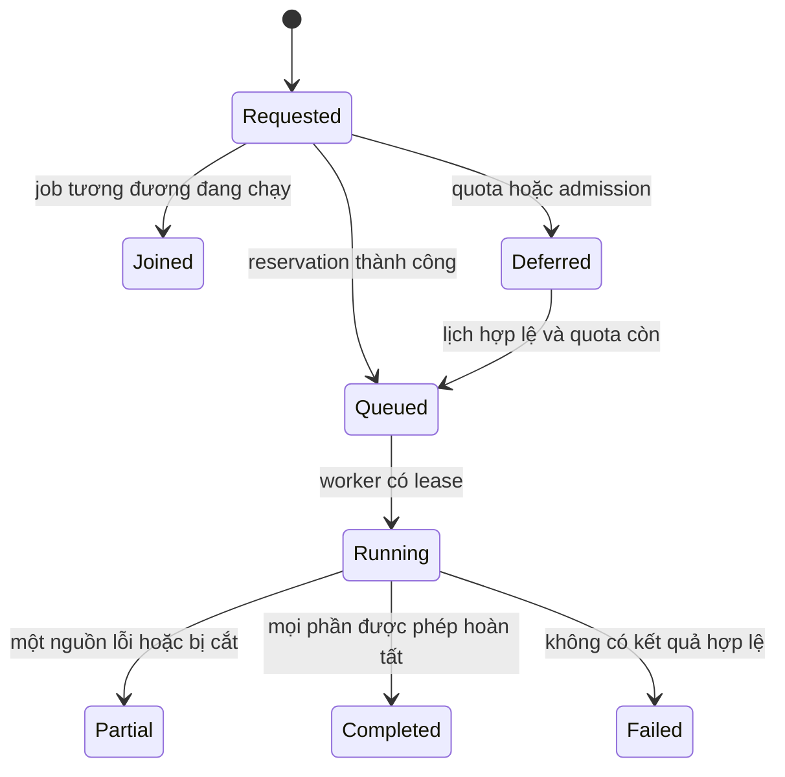

# TrendScout — Phân tích nghiệp vụ US Trend & Keyword Discovery

**Trạng thái:** thiết kế D4; các thành phần D5/D6 dưới đây là đề xuất triển khai, chưa xác minh live. **Rà soát:** 11/11/2026. Danh mục nguồn và giới hạn chứng cứ: [US platform inventory](US_PLATFORM_SOURCE_INVENTORY.md). Handoff kỹ thuật: [D5 blueprint](D5_FOUR_SOURCE_LIVE_INTEGRATION_BLUEPRINT.md).

## 1. Executive summary

TrendScout phục vụ doanh nghiệp nghiên cứu thị trường Mỹ để tìm cơ hội phát triển hoặc nhập khẩu sản phẩm. **Keyword là đầu ra chính**: cụm từ, chủ đề, phân loại, biến động theo thời gian, nguồn, độ mới, phạm vi, mức liên quan US, độ tin cậy và giải thích. Fashion và Home & Living được ưu tiên trong hàng đợi nghiên cứu; hệ thống vẫn phải giữ lĩnh vực khác và một nhóm chưa phân loại. Gợi ý nhóm sản phẩm là đầu ra phụ, không dự báo doanh số và không làm thay đổi điểm trend.

Thiết kế đi theo `DISCOVER → EXTRACT → DETECT → VERIFY → EXPLAIN`. Search theo 14 seed chỉ kiểm tra một tập câu hỏi đã biết; không thể tự chứng minh đã phát hiện mọi chủ đề mới của Mỹ. Phase 1 chỉ được xem xét bốn nguồn Wikimedia, Google SERP và Bing SERP qua SerpApi, YouTube Data API v3; live và chi phí cần phê duyệt riêng. Các nguồn xã hội khác nằm trong danh mục chiến lược, không nằm trong runtime Fetch.

## 2. Business context

Nhà nghiên cứu cần phân biệt điều đang được nhắc đến, mức tăng so với một baseline có thể so sánh, và cơ hội sản phẩm cần kiểm chứng độc lập. Nội dung bằng tiếng Anh, kết quả tìm kiếm được địa phương hóa US hay video xem được ở US không xác nhận tác giả, người xem hoặc nhu cầu mua tại US. Phạm vi quan sát hợp lệ rộng hơn hai ngành ưu tiên nhưng không được diễn đạt thành đại diện toàn bộ dân số.

## 3. Stakeholders và personas

| Người dùng/chủ sở hữu | Nhu cầu | Quyền quyết định |
|---|---|---|
| Researcher thị trường | Tìm keyword, lọc theo lĩnh vực, mở bằng chứng và lịch sử | Gắn nhãn cần nghiên cứu; không phê duyệt nguồn |
| Buyer/R&D | Xem nhóm sản phẩm gợi ý và nguồn gốc gợi ý | Thẩm định cung ứng, IP, quy định và nhu cầu bằng nghiên cứu riêng |
| Product owner | Quy định thứ tự ngành, mức đủ bằng chứng và UAT | Chấp thuận KPI, ưu tiên và phạm vi |
| Data steward/legal | Xác định quyền sử dụng, xóa, lưu và attribution | Phê duyệt theo provider và mục đích |
| Backend/operator | Vận hành quota, trạng thái, chi phí và sự cố | Cấu hình server trong giới hạn được phê duyệt |
| Người xem công khai | Nhấn Fetch, xem tình trạng và kết quả | Không cần tài khoản, credential, provider hay run ID |

## 4. Mục tiêu và KPI

Các ngưỡng sau là **đề xuất đo và cần chủ sản phẩm chốt**, không phải hiệu năng đã đo: (1) tỷ lệ keyword có ít nhất một evidence mở được và nguồn/thời điểm/phạm vi hiển thị 100%; (2) 100% kết quả không đủ baseline mang nhãn insufficient thay vì điểm tăng trưởng; (3) 100% job hiển thị trạng thái từng nguồn, freshness và truncation; (4) chi phí đặt trước không vượt ngân sách đã cấu hình; (5) đánh giá thủ công mẫu phân tầng Fashion/Home/khác: precision của keyword hữu ích, tỷ lệ trùng, thời gian từ quan sát đến hiển thị và tỷ lệ US evidence đủ điều kiện. Ghi phương pháp lấy mẫu, mẫu số, khoảng tin cậy và kỳ đo trước khi đặt mục tiêu số.

## 5. As-Is D3A/D3B

D3A có website công khai, capability API và Public Fetch synthetic mặc định tắt, chỉ local/test có fixture; giới hạn process-local không bảo vệ production phân tán. Legacy `POST /api/runs` vẫn cần Bearer operator. Vercel hiện read-only. D3B có YouTube query adapter chỉ MockTransport và evidence theo query, chưa kết nối live. Wikimedia demo có metric top-list bị kiểm duyệt; không thay schema/Golden bằng SERP. D4 thêm hai adapter offline và không tích hợp vào Public Fetch. Xem [D3A admission](DEMO_PUBLIC_FETCH_AND_ADMISSION.md), [D3B report](../Reports/BAO_CAO_DEMO_D3B.md) và [source capabilities](DEMO_ONLINE_SOURCE_CAPABILITIES.md).

## 6. To-Be architecture

```mermaid
flowchart LR
    U[Người xem công khai] --> API[Capability và Fetch API]
    API --> AD[Distributed admission, idempotency, quota reservation]
    AD --> Q[Durable queue và job state]
    Q --> S[Scheduler và adapter được phê duyệt]
    S --> C[Snapshot/cache có provenance và TTL theo quyền]
    C --> E[Extract và normalize]
    E --> D[Detect theo nguồn và baseline tương thích]
    D --> V[Verify chọn lọc theo quota]
    V --> X[Evidence, coverage, confidence và explain]
    X --> UI[Dashboard và lịch sử]
```

Mũi tên là ownership đề xuất cho D5, không xác nhận hạ tầng đã tồn tại. Adapters chỉ phát hành kết quả qua hợp đồng source-specific; extraction, scoring và product suggestion có version riêng.

## 7. Functional requirements

| ID | Hành vi và tiêu chí |
|---|---|
| FR-01 | Đọc capability công khai; Fetch chỉ là một hành động, không yêu cầu login, credential, query hay provider. |
| FR-02 | Backend quyết định nhận job mới, nhập job đang chạy, trả cache được phép hoặc deferred; trả lý do và trạng thái từng nguồn. |
| FR-03 | Tạo ứng viên từ nguồn discovery hợp lệ; giữ từ/cụm chưa có trong taxonomy. |
| FR-04 | Chuẩn hóa biến thể có provenance; cho phép một entity liên kết nhiều query và evidence. |
| FR-05 | Phân loại temporal theo nguồn/cửa sổ; insufficient là trạng thái có thể hiển thị. |
| FR-06 | Lọc, tìm, xem chi tiết, lịch sử, freshness, coverage, địa lý và hạn chế; chỉ link evidence được phép. |
| FR-07 | Cho phép Fashion/Home được ưu tiên trong research queue; không chặn các lĩnh vực khác. |
| FR-08 | Gợi ý category có lý do và nhãn đề xuất; không phải score hay dự báo bán hàng. |
| FR-09 | Hiển thị partial, quota, cache stale, từ chối, truncation và thời gian làm mới; không đổi dữ liệu cũ thành fetch mới. |

## 8. Non-functional requirements

Bounded time, bytes, pagination, retry và concurrency ở từng adapter; durable idempotency và atomic reservations trên nhiều process; khôi phục job sau crash; observability không chứa secrets hay query nhạy cảm; schema version; bảo vệ cost; accessibility, responsive, VI/EN và light/dark tiếp tục được kiểm tra. Mục tiêu độ trễ, throughput, RPO/RTO và ngân sách production cần đo bằng workload và được duyệt trước D6.

## 9. Business rules

BR-01: missing khác zero; top-list absence không phải zero. BR-02: mỗi metric giữ định nghĩa, đơn vị, window, population và source. BR-03: chỉ so sánh các cửa sổ tương thích và đủ support; baseline thiếu/zero không được tạo phần trăm vô hạn. BR-04: tách kết quả provider, chỉ số dẫn xuất và nhận xét của TrendScout. BR-05: không cộng trực tiếp SERP position, pageviews và số video. BR-06: dữ liệu bị xóa, hết quyền hoặc hết TTL không được trả lại từ cache. BR-07: không bypass quota bằng đổi key, identity hay proxy.

## 10. Complete platform inventory summary

Danh mục nghiên cứu trải trên mainstream social, messaging/community, video/creator, social commerce, marketplace/retail, news/open datasets và sở thích. Nhiều content surface cùng parent và API/quota không được tính thành provider độc lập. Inventory ghi phạm vi, ngày, nguồn, mức chưa xác minh và review định kỳ; nó không chứng nhận mọi nền tảng US đã được biết đến. [Inventory chi tiết](US_PLATFORM_SOURCE_INVENTORY.md).

## 11. Source prioritization matrix

Ưu tiên nghiệp vụ và khả năng truy cập là hai trục độc lập. Wikimedia là broad nhưng top-list censored; Google/Bing là query verification; YouTube là query-based hybrid phụ thuộc quota và policy. Pinterest/TikTok/Reddit có thể phù hợp ngành nhưng cần quyền riêng và không thuộc bốn nguồn live phase 1. Chấm từng nguồn theo relevance, tính mới, US evidence, độ lệch mẫu, quyền, chi phí, freshness và độ bền, ghi lý do cùng người duyệt; không tăng điểm chỉ vì API dễ dùng.

## 12. Data discovery strategy

Broad discovery lấy top lists, feed hoặc dataset được cấp quyền theo lịch và phạm vi rõ; query sources xác minh có chọn lọc thay vì tìm toàn bộ tổ hợp keyword × nguồn. Bốn nguồn đầu tạo sample hữu ích nhưng curated seeds và kết quả xếp hạng không bao phủ mọi trend. Không mở rộng live scope để lấp khoảng trống này khi chưa được duyệt.

## 13. Keyword extraction

Xử lý language detection, câu/cụm nhiều từ, entity, lỗi mã hóa và spam trước khi tạo candidate; giữ input provenance và phiên bản pipeline. Deduplicate nội dung và near-duplicate có ngưỡng kiểm thử, giữ liên hệ nhiều query. Nội dung bị từ chối vẫn có count và reason; không suy ra toàn văn từ snippet. Đo precision/recall trên tập đánh giá có gán nhãn và drift theo ngành/ngôn ngữ.

## 14. Phrase/entity normalization

Unicode normalization, case-fold và whitespace là bước xác định; synonym, viết tắt, tên riêng hoặc entity resolution có confidence và cho phép tách nhầm lẫn. Giữ original form, canonical form, version, mapping evidence và khả năng sửa; tránh gộp tên người và sản phẩm chỉ vì trùng chữ.

## 15. Taxonomy

Taxonomy đa nhãn có version, parent/child, `unknown` và quy trình review. Clothing, footwear, accessories, bags thuộc Fashion; home organization, kitchen, storage, decor, household products thuộc Home & Living. Chủ đề giải trí, công nghệ, sức khỏe và lĩnh vực khác không bị loại. Mapping keyword → taxonomy không đồng nghĩa khẳng định sản phẩm.

## 16. New keyword detection

`NEW_IN_OBSERVED_CORPUS` chỉ khi có lịch sử thu thập đủ dài, scope và phương pháp ổn định, trước đó không tìm thấy và hiện đủ support. Thiếu lịch sử là `INSUFFICIENT_EVIDENCE`, không kết luận mới trên Internet. Phát hiện thay đổi taxonomy, source coverage hay parser phải đánh dấu đứt chuỗi.

## 17. Trend growth detection

Emerging, accelerating, sustained, stable, declining, seasonal và insufficient là nhãn theo source/metric/window; cần support, baseline, exposure và kiểm soát trùng/noise. Đề xuất so sánh median baseline theo ngày trong tuần và rolling windows, kiểm tra độ bền trên nhiều bucket; ngưỡng và công thức cần backtest, version và product approval. Raw mentions hay một spike đơn lẻ không đủ.

## 18. Temporal baselines

Mỗi điểm thời gian có event/observation/collection time, window, completeness, sampling và offset. Chỉ so sánh bucket cùng timezone, phương pháp và phạm vi; đánh dấu ngày thiếu, chậm, censored, bất thường hoặc nguồn thay đổi. Cửa sổ theo mùa phải có đủ lịch sử nhiều chu kỳ; chưa đủ thì không gắn seasonal.

## 19. US-market evidence

Lưu mức bằng chứng theo nguồn: pageview country US là geography của lượt xem tổng hợp, không xác định danh tính; `gl=us`, `mkt=en-US`, YouTube region filter là targeting/scope, không chứng minh audience hay tác giả US. Nội dung nêu địa điểm hoặc nguồn US có thể cung cấp evidence bổ sung nhưng cần kiểm tra nguồn. UI hiển thị `US_SCOPE_FILTER_ONLY`, `US_EVIDENCE_SUPPORTED` hoặc `UNKNOWN` theo quy tắc được duyệt, không gán nhãn US demand chỉ bằng ngôn ngữ.

## 20. Source coverage

Đếm nguồn đã lên lịch, được phép, thành công, partial, lỗi và chưa chạy; ghi query, page cap, sample, exclusions, freshness và coverage window. Bốn nguồn không là mẫu xác suất của dân số Mỹ; thiếu nguồn không phải không có tín hiệu. Hiển thị phạm vi ngay cạnh kết luận.

## 21. Trend confidence

Đề xuất confidence là nhãn chất lượng có thể giải thích từ support, completeness, consistency, independence, temporal depth và US evidence; chưa phải xác suất. Không bù thiếu baseline bằng điểm volume cao. Lưu từng thành phần, phiên bản, lý do và giới hạn; calibration chỉ sau đánh giá độc lập.

## 22. Cross-source limitations

Giữ evidence gốc và các nhóm phụ thuộc: cùng trang có thể xuất hiện trong Google, Bing và Wikipedia; hai SERP qua một SerpApi account có chung quota và có thể trùng corpus. So khớp URL/entity là tín hiệu trùng, không chứng minh nguồn độc lập. Không ép keyword phải xuất hiện ở cả bốn nguồn.

## 23. Fashion/Home business prioritization

Ưu tiên hàng chờ, filter và đánh giá mẫu cho Fashion/Home; công thức trend và support rule áp dụng bình đẳng. Một keyword đa lĩnh vực giữ mọi nhãn; topic ngoài ngành vẫn được discover và hiển thị. Không tính xếp hạng listing thành doanh số.

## 24. Product suggestion rules

Chỉ gợi ý category khi mapping có evidence và độ phù hợp đủ ngưỡng được duyệt; cho phép không có gợi ý. Hiển thị lý do, nguồn và nhãn hypothesis; nghiên cứu giá, cạnh tranh, an toàn sản phẩm, IP, nhập khẩu và nhu cầu mua diễn ra riêng.

## 25. Quota optimization

Dedup request theo source/query/filter/version/freshness; chia sẻ collection job giữa người dùng; atomic reserve per-provider và shared SerpApi pool trước request kể cả retry. Bounded retries, `Retry-After`, page cap và deadline; dừng khi quota cạn. Không rotate keys hay bypass. Cost telemetry phân biệt dự trù bảo thủ và charge thực tế sau reconciliation.

## 26. Persistent cache strategy

Cache key gồm source, provider, query fingerprint, filter, version và window. Lưu fetched/observed time, expiry, permission basis, source status, cache provenance và parser version; single-flight refresh. TTL, deletion, attribution và quyền lưu theo từng provider, không đặt chung tùy tiện. Khi quota hết có thể trả snapshot còn được phép kèm tuổi và trạng thái stale; không trả dữ liệu đã hết quyền.

## 27. Incremental collection

Dùng watermark/cursor được provider hỗ trợ và bind với source, query, filter, plan version; overlap có kiểm soát, dedup, xử lý late arrival và invalid cursor. Không tuyên bố đầy đủ từ cursor hoặc ước lượng số kết quả. Nếu provider không hỗ trợ incremental, thu snapshot có giới hạn và ghi rõ sample.

## 28. Distributed queue

D5 cần durable queue, job state, lease/fencing, idempotent writes, retry có giới hạn, recovery khi worker chết và atomic quota/cost reservation giữa host. Thiết kế at-least-once phải chịu duplicate và có dead-letter/alert. Global admission, cooldown, concurrency và bot controls không dựa vào Origin/IP đơn lẻ; direct clients, nhiều IP/process và restart đều nằm trong threat model.

## 29. Error và partial result handling

Trạng thái source gồm success, partial, empty, rejected, deferred, quota, rate-limited, timeout, stale và failed; lỗi an toàn không chứa key hay raw URL. Một source lỗi không xóa evidence hợp lệ nguồn khác; job partial không báo success toàn bộ. Retry budget, số trang và lý do dừng được lưu. Kết quả rỗng hợp lệ khác JSON hỏng hoặc hết quota.

## 30. Security & data governance

Credential chỉ ở backend secret manager; không đưa token/provider vào browser hoặc log. Fixed plan, host allowlist, kiểm soát redirect, kích thước response, untrusted text và URL, least privilege, monitoring và kill switch. Với private messages/groups, chỉ truy cập khi quyền và mục đích được phê duyệt; không thu thập riêng tư mặc định. Theo dõi deletion, takedown, retention, attribution và hợp đồng từng nguồn; không mặc định quyền scrape listing/review.

## 31. Provider approval matrix

| Provider | Quyền/chi phí | Retention/attribution | Trạng thái D4 |
|---|---|---|---|
| Wikimedia AQS | Xác minh policy, user-agent và live scope | Kiểm tra điều khoản dữ liệu và hiển thị | Offline baseline; live chưa phê duyệt |
| SerpApi Google/Bing | Cùng account/quota; duyệt điều khoản, giá, mục đích và quyền nội dung | Review bản quyền, cache và xóa | Adapter synthetic; chưa cấu hình |
| YouTube Data API v3 | Duyệt project, quota, use case và Developer Policies | Review derived metrics, deletion và attribution | Adapter synthetic; chưa cấu hình |
| Nguồn tương lai | Phê duyệt từng provider và use case | Theo policy cụ thể | Không thuộc live Phase 1 |

## 32. Dashboard requirements

Giữ D2 light/dark, VI/EN, responsive, search/filter/detail, source status và accessibility. Fetch có trạng thái accepted/running/deferred/partial/failed/completed và nguồn, không đòi login. Keyword detail hiển thị evidence, baseline, phân loại, freshness, coverage, US evidence và limitation; dữ liệu stale được gắn nhãn. Không hiển thị credentials hoặc nội dung raw không được phép.

## 33. Data contracts

`SourceCapability` tách implementation, approval, configuration, live verification và data mode. `CollectionJob` có idempotency key server, plan fingerprint, budgets, deadline, per-source state và timestamps. `SourceObservation` có source/provider, entity ID, event/observation/fetched time, sample scope, raw metric descriptor, quality flags và schema version; `QueryEvidence` nhiều-một giữ query, page, rank, filters và provenance cache. `KeywordCandidate` có forms, taxonomy version, evidence refs, data quality; `TrendAssessment` có baseline/window, support, source-specific metrics, rule version, classification và explanation; `ProductHypothesis` tách riêng. Contract này là D5 proposal, không thay schema hiện hữu D4.

## 34. Luồng trạng thái

## 35. User journeys

1. Người xem mở dashboard → xem coverage/freshness → nhấn Fetch → backend nhập job hoặc từ chối có lý do → xem từng nguồn và keyword evidence.
2. Researcher lọc Fashion/Home → mở keyword và baseline → đọc giới hạn US và nguồn → lưu câu hỏi nghiên cứu sản phẩm ngoài score.
3. Provider hết quota → job deferred hoặc trả snapshot còn quyền với timestamp → operator xem budget và cảnh báo; không né quota.

## 36. Alternatives và trade-offs

Chỉ SERP đơn giản nhưng bị seed/query bias và không phát hiện chủ đề chưa biết; broad feed có thể tăng coverage nhưng policy, privacy và cost khó hơn. In-memory queue dễ test nhưng mất trạng thái khi restart và không chống nhiều process; durable queue/store tăng chi phí và vận hành. Một score chung dễ đọc nhưng làm mất đơn vị và che bias; chọn source-level evidence cùng classification có giải thích.

## 37. Cost và capacity scenarios

Giả định 14 seeds × một page × hai SERP engines = tối đa 28 attempt cho một batch không retry; 1/4/24 batch mỗi ngày trong 30 ngày tương ứng 840/3.360/20.160 attempts trước retry, cache và thất bại. YouTube thêm tối đa 14 first-page calls/batch; Wikimedia có quota/rate và cache riêng. Theo [SerpApi pricing](https://serpapi.com/pricing) truy cập 11/11/2026, các gói và hourly throughput thay đổi; successful search tính vào monthly allowance, cached/error có quy tắc riêng. Ví dụ 840 successful searches nằm dưới 1.000/tháng của gói được công bố $25/tháng, nhưng chưa tính thuế, giờ cao điểm, chi phí khác hoặc phê duyệt mua. Dự trù reserve mọi attempt là bảo thủ, không suy ra hóa đơn hay quota tài khoản thực.

## 38. D4–D5–D6–D7 delivery map

D4: thiết kế và adapters MockTransport, fixture tests, inventory; không live. D5: xây dựng live-capable code cho bốn nguồn, distributed admission/queue, quota/cache, orchestration, extraction và UI; nghiệm thu bằng offline evidence. D6: tài khoản provider thuộc tổ chức, credential management, admin console riêng và xác minh/kích hoạt live từng nguồn sau phê duyệt. D7: final live E2E, security, data quality, performance và UAT. Mỗi nguồn chỉ `LIVE_VERIFIED` sau bằng chứng riêng. Không có D3C. Xem [D6 plan](D6_PROVIDER_ACCOUNT_CREDENTIAL_AND_LIVE_ACTIVATION_PLAN.md).

## 39. Acceptance cases

Given baseline thiếu, when nhận một spike, then hiển thị insufficient. Given cùng URL từ hai query, then giữ cả hai evidence. Given quota cạn, then dừng request và hiển thị deferred/stale có timestamp. Given một provider lỗi, then job partial giữ nguồn khác và lý do. Given SERP rank cao, then không hiển thị search volume/sales. Given keyword không thuộc Fashion/Home, then vẫn hiển thị theo taxonomy. Given bốn nguồn chưa đại diện toàn US, then coverage được mô tả rõ. D6 cần evidence live riêng và D7 cần UAT riêng, không suy luận từ fixture.

## 40. Risks, quyết định mở và references

| ID | Quyết định/rủi ro | Chủ sở hữu và hành động |
|---|---|---|
| D4-01 | Bốn nguồn live phase 1; public không đăng nhập | Product đã xác định; live activation cần approval |
| D4-02 | Discovery-first; SERP là verification | Data/product chọn nguồn broad hợp lệ sau phase 1 |
| D4-03 | Fashion/Home ưu tiên hàng đợi, product suggestion tách score | Product chốt quy tắc và KPI |
| D4-04 | Distributed controls là điều kiện live | Engineering/security thiết kế và kiểm thử D5 |
| O-01 | Provider terms, retention, attribution, derived metrics và chi phí chưa duyệt | Legal/data steward review từng nguồn |
| O-02 | Ngưỡng support, confidence, seasonal, KPI, taxonomy và US evidence | BA/data science backtest và product duyệt |
| O-03 | Hosting, durable store/queue, SLO, chi phí và abuse controls | Engineering/operations quyết định dựa trên workload |

Nguồn chính: [Pew US 2026](https://www.pewresearch.org/internet/fact-sheet/social-media/), [SerpApi Google](https://serpapi.com/search-api), [SerpApi Bing](https://serpapi.com/bing-search-api), [SerpApi legal](https://serpapi.com/legal), [YouTube search.list](https://developers.google.com/youtube/data/reference/rest/v3/search/list), [Wikimedia Pageviews](https://wikitech.wikimedia.org/wiki/Analytics/AQS/Pageviews). Rà soát 11/11/2026; tài liệu provider không chứng minh access hay quyền sử dụng của TrendScout.
