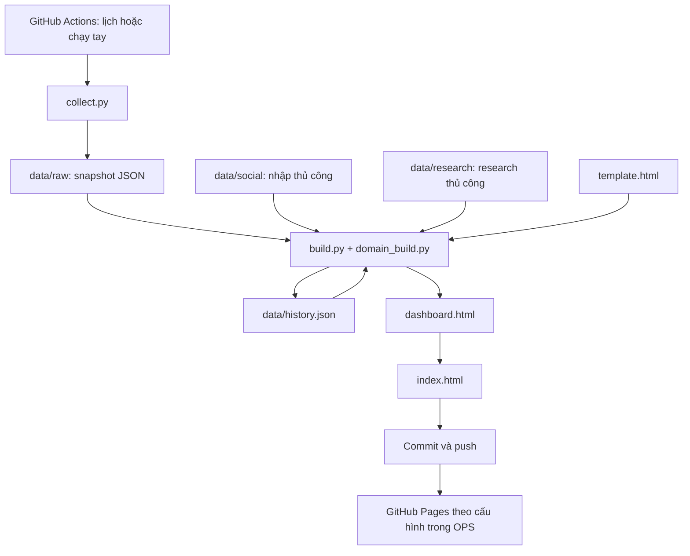

# TrendScout — Requirement và công nghệ cho BA/Dev

**Ngày tổng hợp:** 09/11/2026. **Mã nguồn khảo sát:** commit `80b3d1e`.

Tài liệu giúp BA hiểu bài toán, phạm vi và quy tắc nghiệp vụ; giúp dev hiểu hệ thống đang chạy, dữ liệu, cách dựng dashboard và các điểm cần lưu ý khi sửa. Đây là bản mô tả hiện trạng được tái dựng từ code và tài liệu bàn giao, **chưa phải đặc tả requirement đã được stakeholder phê duyệt**.

Tài liệu này khảo sát **repo tham khảo** `mavirrt/trendscout` tại commit nêu trên; các file mã nguồn được liên kết tới repo đó, không phải mã nguồn đã triển khai trong repo TrendScout mới.

Nguồn đối chiếu:

- **CODE:** mã nguồn, cấu hình, workflow, dữ liệu và `index.html` trong repo.
- **HD:** [HUONG_DAN.md](https://github.com/mavirrt/trendscout/blob/80b3d1e4b9d3175c810a708041953139c1fc352f/HUONG_DAN.md), hướng dẫn nhanh hiện có.
- **OPS:** “TrendScout — Tài liệu vận hành”, ngày 06/11/2026, do người dùng cung cấp bổ sung trong cuộc trao đổi. Bản này mô tả cả môi trường Windows ngoài repo; các thông tin cần thiết được tổng hợp ngay trong tài liệu dưới đây.

Các nội dung gắn **“theo OPS”** chưa có đủ bằng chứng trong checkout này. Các mục **“cần xác nhận”** và **“đề xuất”** không được hiểu là chức năng đã có hoặc yêu cầu đã chốt. Không kiểm tra trực tiếp các dịch vụ bên ngoài hay cài đặt tài khoản GitHub trong lần khảo sát này.

## 1. Bài toán và giá trị nghiệp vụ

TrendScout tổng hợp tín hiệu xu hướng phục vụ nghiên cứu **thị trường Mỹ**, trình bày trên dashboard tiếng Việt. Người dùng có thể tìm chủ đề đang được quan tâm, đối chiếu nhiều nguồn, xem độ nóng của ngách và chuyển sang nghiên cứu ý tưởng sản phẩm.

| Nhu cầu nghiệp vụ | Hệ thống hỗ trợ hiện tại | Giới hạn cần hiểu |
|---|---|---|
| Biết chủ đề/người/tác phẩm nào đang nổi | Google Trends, Wikipedia, bảng xếp hạng, tin tức, MXH | Đo sự chú ý trong tập dữ liệu thu thập; chưa chứng minh nhu cầu mua |
| Chọn ngách để nghiên cứu | Tin theo ngách, tỷ lệ tin mới, số quảng cáo Facebook | Chưa có doanh số, lợi nhuận, tỷ lệ chuyển đổi hoặc lượng tồn kho |
| Chuẩn bị sản phẩm theo mùa | Lịch lễ, tin và bài MXH liên quan | Lịch/số ngày còn lại được chốt tại lần thu thập, không cập nhật trực tiếp khi mở trang |
| Tìm hướng sản phẩm | Ý tưởng research thủ công và gợi ý theo quy tắc | Không có mô hình AI sinh nội dung trong pipeline Python |
| Chia sẻ kết quả cho đồng nghiệp | Một file HTML tự chứa và bản online theo OPS | Không có đăng nhập/phân quyền người xem trong ứng dụng |

**Nhóm sử dụng:** người nghiên cứu thị trường, RnD/sản phẩm, người vận hành. Vai trò BA, dev và chủ sản phẩm dưới đây là cách phân chia trách nhiệm bàn giao; hệ thống không triển khai các vai trò đó thành tài khoản.

**Phạm vi hiện có:** thu thập định kỳ, nhập bổ sung JSON thủ công, tổng hợp/xếp hạng, tìm kiếm/lọc, biểu đồ lịch sử và xuất HTML.

**Chưa có trong repo:** quản lý tài khoản, dashboard quản trị nhập liệu, API backend phục vụ người dùng, database server, thanh toán, cảnh báo chủ động, xuất Excel/PDF, dự báo doanh số hay tự động quét TikTok/Facebook. Liên kết sàn thương mại điện tử chủ yếu là link tìm kiếm/tham khảo, không phải tích hợp đặt hàng hay đồng bộ giá.

## 2. Phạm vi dữ liệu và người chịu trách nhiệm

### 2.1. Ba cách phân loại khác nhau

BA/dev cần phân biệt ba khái niệm, vì chúng không dùng chung một danh mục:

| Khái niệm | Ý nghĩa | Nơi cấu hình |
|---|---|---|
| Lĩnh vực — `domain` | 10 lĩnh vực: mùa lễ, game, thể thao, âm nhạc, idol/người nổi tiếng, phim, TV/series/anime, công nghệ/app, sách/podcast, thời sự | `domains.py:DOMAINS`; thứ tự hiển thị tại `domain_build.py:ORDER` |
| Ngách — `niche` | 15 truy vấn sản phẩm đang theo dõi | `config.json:niches` |
| Nhóm ngành — `category` | 10 nhóm tiêu dùng và “Khác”, gắn theo từ khóa trong tiêu đề/truy vấn | `build.py:CATS`, `categorize()` |

15 ngách hiện tại: `skincare`, `supplement`, `air fryer`, `pet products`, `home decor`, `kitchen gadget`, `fitness`, `baby products`, `phone accessories`, `cleaning products`, `hair care`, `water bottle`, `protein`, `matcha`, `sleep`.

### 2.2. Trách nhiệm vận hành

| Công việc | Người/thành phần thực hiện | Trạng thái |
|---|---|---|
| Thu thập nguồn công khai và dựng HTML hằng ngày | GitHub Actions | Có workflow trong repo |
| Quét TikTok Creative Center và Meta Ad Library | Người vận hành qua Claude có trình duyệt và phiên đăng nhập phù hợp | Quy trình ngoài repo theo OPS; kết quả JSON có trong repo |
| Research ý tưởng sản phẩm và bằng chứng | Người research/RnD | Nhập file JSON; pipeline chỉ đọc và hiển thị |
| Sửa danh sách ngách/truy vấn | Người vận hành hoặc dev | Sửa `config.json`, thu thập và dựng lại |
| Sửa nguồn, phân loại, trọng số, giao diện | Dev | Sửa Python hoặc `template.html` |
| Chốt cách hiểu điểm số, chất lượng dữ liệu, ưu tiên tính năng | BA và chủ sản phẩm | Cần thống nhất qua các câu hỏi ở mục 11 |

## 3. Requirement chức năng và tiêu chí kiểm tra

Các mã FR dùng để trao đổi và truy vết trong tài liệu này. Tiêu chí dưới đây mô tả hành vi đang có để BA/dev kiểm tra lại; không phải bộ UAT đã được ký duyệt.

| ID | Chức năng/yêu cầu hiện trạng | Tiêu chí kiểm tra cụ thể | Bằng chứng |
|---|---|---|---|
| FR-01 | Thu thập tín hiệu từ các nguồn tự động | Chạy `collect.py` tạo snapshot JSON có `collected_at`, `status`, `items`, `domains`; một nguồn lỗi không nhất thiết dừng các nguồn khác | `collect.py:main()`, `domains.py:collect_all()` |
| FR-02 | Cấu hình ngách và truy vấn tiêu dùng | Thay `niches`/`buzz_queries`, thu thập rồi build lại để áp dụng; cửa sổ tin chung mặc định `7d` | `config.json`, `collect.py:google_news()` |
| FR-03 | Tổng quan | Có 4 KPI; thẻ lĩnh vực có tối đa 5 trend; bấm thẻ chuyển sang chi tiết; có cụm từ nổi bật và Google Trends | `template.html`, tab Tổng quan |
| FR-04 | Xếp hạng theo lĩnh vực | Lĩnh vực thông thường có tối đa 25 trend, điểm 0–100, nhãn mới, tín hiệu và link tin; mùa lễ có bảng trình bày riêng | `domain_build.py:domain_rankings()`, `renderDomain()` |
| FR-05 | Phân tích ngách | Mỗi ngách có số tin, số tin trong 48h, momentum, cụm liên quan, tối đa 3 tiêu đề và số quảng cáo FB nếu có; sắp momentum giảm dần | `build.py:main()`, `#nicheBody` |
| FR-06 | Chủ đề người tiêu dùng | Tạo tối đa 30 cụm hai từ từ tin nhóm `buzz`, xuất hiện ít nhất 2 lần; mở cụm để xem tối đa 5 tin ví dụ | `build.py`, `#buzz` |
| FR-07 | Theo dõi mùa lễ | Tính lịch từ 3 ngày đã qua đến 70 ngày tới, gồm năm hiện tại và năm kế tiếp; hiển thị ngày, số ngày còn lại, tin, MXH và cụm từ | `domains.py:upcoming_holidays()`, `season_block()` |
| FR-08 | Xem Bluesky/YouTube | Có trending Bluesky; lọc bài/video theo lĩnh vực và nguồn; danh sách chung bỏ trùng URL, hiển thị tối đa 40 mục | `collect_social()`, `template.html:renderSoc()` |
| FR-09 | Đọc dữ liệu TikTok/Facebook bổ sung | Build đọc tất cả file `data/social/*.json`; có lọc ngành TikTok, hashtag, lượt đăng/xem, quảng cáo FB và thời điểm quét | `build.py:load_social()`, tab Mạng xã hội |
| FR-10 | Hiển thị research sản phẩm thủ công | Chọn một file research có tên xếp cuối; hiển thị ý tưởng, nhóm, thời điểm, ghi chú IP, bằng chứng, sản phẩm và link tìm kiếm; lọc theo nhóm | `build.py`, `template.html:renderRes()` |
| FR-11 | Sinh gợi ý sản phẩm theo quy tắc | Trend thông thường thuộc nhóm được hỗ trợ và có ≥2 tín hiệu mới được xét; mùa lễ dùng nhánh riêng; có lý do và link 4 sàn | `domain_build.py:auto_ideas()` |
| FR-12 | Tìm kiếm/lọc feed | Lọc đồng thời theo chuỗi trong tiêu đề, nguồn, nền tảng được nhắc, nhóm ngành; payload tối đa 800 tin, UI tối đa 200 kết quả | `build.py`, `template.html:renderFeed()` |
| FR-13 | Theo dõi lịch sử | Một giá trị/ngách hoặc lễ/ngày UTC; giữ 35 ngày có dữ liệu gần nhất; cần ít nhất 2 giá trị để vẽ đường; nhớ lựa chọn trên trình duyệt | `update_history()`, `drawLineChart()`, `localStorage` |
| FR-14 | Dựng và chia sẻ dashboard | `build.py` xuất một `dashboard.html` tự chứa; workflow sao chép thành `index.html`, commit/push khi có thay đổi | `build.py`, `.github/workflows/daily.yml` |
| FR-15 | Hiển thị trạng thái dữ liệu | Header hiện giờ snapshot, giờ snapshot trước; có trạng thái nguồn và giờ quét TikTok/FB; chưa có cảnh báo tự động theo ngưỡng dữ liệu cũ | `template.html:203–207`, `230` |

**Lưu ý FR-12:** “Tất cả tín hiệu” hiện chỉ là feed tin chung/Reddit nếu có trong `items`, không phải toàn bộ Wikipedia, chart và bài MXH. Tên tab rộng hơn phạm vi dữ liệu thực tế. Bộ chọn nguồn hiện chỉ có lựa chọn Google News ngoài “Mọi nguồn”.

## 4. Các luồng sử dụng chính

### 4.1. Từ phát hiện trend đến nghiên cứu sản phẩm

1. Người dùng mở dashboard, kiểm tra thời điểm quét và tình trạng nguồn.
2. Xem Tổng quan để chọn lĩnh vực hoặc ngách đáng quan tâm.
3. Vào Theo lĩnh vực để xem điểm, các tín hiệu và tin gốc; hoặc Sản phẩm & ngách để xem momentum.
4. Đối chiếu Mạng xã hội và Lịch sử; phân biệt dữ liệu tự động mới với TikTok/FB nhập trước đó.
5. Mở Gợi ý sản phẩm, xem hướng RnD, bằng chứng và sản phẩm tham khảo.
6. Người nghiên cứu tự đánh giá tiếp nhu cầu mua, khả năng cung ứng, chi phí và quyền sử dụng nội dung. Hệ thống chưa có bước lưu quyết định/duyệt ý tưởng.

### 4.2. Cập nhật tự động



Build chọn hai file raw cuối theo **thứ tự tên file**, không chọn theo timestamp bên trong JSON. Một snapshot đủ để build; snapshot thứ hai cung cấp dữ liệu so sánh. Khi chưa có bản trước, không đánh dấu mới dựa trên so sánh lần quét.

### 4.3. Cập nhật thủ công TikTok/Facebook

Theo OPS: người vận hành dùng Claude có kết nối máy/trình duyệt để lấy hashtag từ TikTok Creative Center và số quảng cáo từ Meta Ad Library; ghi JSON mới vào `data/social/`, build lại rồi xuất bản. Tần suất được hướng dẫn là 1–2 lần/tuần.

Đây là quy trình hỗ trợ bên ngoài chương trình. Repo không chứa script đăng nhập/quét hai dịch vụ này; không có nút cập nhật dữ liệu trong dashboard.

## 5. Quy tắc nghiệp vụ và cách đọc chỉ số

### 5.1. Điểm trend thông thường: 4 nhóm tín hiệu

Code dùng **Wikipedia, tin tức, bảng xếp hạng và MXH**. HD, OPS và phần mô tả trên UI vẫn nói “3 tín hiệu”; cần cập nhật cách diễn giải nếu giữ công thức hiện tại.

Trong mỗi lĩnh vực và mỗi lần build:

```text
W = sqrt(lượt xem Wikipedia / lượt xem Wikipedia lớn nhất trong lĩnh vực)
    Nếu Wikipedia là MỚI hoặc tỷ lệ so tuần trước >= 2:
        W = min(1, W + 0.15)
C = max(1 - (rank - 1) / số dòng của từng chart)
N = sqrt(số tin nhắc tới / số tin nhắc tới lớn nhất trong lĩnh vực)
S = sqrt(tổng engagement / tổng engagement lớn nhất trong lĩnh vực)
k = số nhóm tín hiệu thực sự có, từ 1 đến 4

Điểm = round(100 × (0.32W + 0.25N + 0.20C + 0.23S + 0.06(k - 1)) / 1.18)
```

Thành phần thiếu nhận giá trị 0; mẫu số chuẩn hóa có xử lý tránh chia 0. Sắp theo điểm giảm dần, sau đó số tin nhắc tới giảm dần; lấy tối đa 25 trend.

**Ý nghĩa:** mức nổi bật tương đối trong tập ứng viên cùng lĩnh vực của lần quét. Không nên coi 80 điểm ở hai lĩnh vực hay hai ngày là cùng một mức nhu cầu thị trường; tập ứng viên, nguồn có dữ liệu và mẫu số có thể thay đổi. Đây không phải xác suất thành công hay phần trăm tăng trưởng.

Ứng viên chủ yếu được tạo từ Wikipedia và chart; riêng idol/TV có thêm thực thể trích từ Soompi. Một tên chỉ xuất hiện trong tin/MXH không tự động trở thành trend được xếp hạng nếu không được tạo thành ứng viên.

Nguồn: `domain_build.py:79–184`, đặc biệt `151–170`.

### 5.2. Engagement MXH

```text
Bluesky engagement = likes + 2 × reposts + 2 × replies
YouTube engagement = floor(views / 1000)
```

Đây là quy đổi trong sản phẩm, không phải cùng một đơn vị tương tác gốc giữa hai nền tảng. Điểm trend lấy dữ liệu Bluesky/YouTube; số hashtag TikTok và quảng cáo Facebook nhập thủ công không tham gia công thức này.

Nguồn: `domains.py:bsky_search()`, `yt_search()`; `domain_build.py:domain_rankings()`.

### 5.3. Đà tăng ngách — momentum

```text
share_ngách = số tin có ngày đăng trong 48h gần snapshot / tổng tin của ngách
baseline = phần tử giữa sau khi sắp share của các ngách có tin
momentum = round(share_ngách / baseline × 100)
```

Nếu không có tin thì share bằng 0; baseline bằng 0 thì momentum bằng 0. Với số ngách chẵn, code lấy phần tử giữa phía trên, không lấy trung bình hai phần tử giữa.

Ví dụ minh họa: ngách có 100 tin, 30 tin trong 48h ⇒ share = 0,30. Nếu baseline của các ngách là 0,20 ⇒ momentum = 150. Ý nghĩa là tỷ trọng tin mới bằng 1,5 lần baseline, **không có nghĩa tăng trưởng 50% so hôm qua**.

UI mô tả “100 = bình thường, >130 = đang nóng lên”, nhưng code không dùng mức đều lý thuyết `2/7`, cũng không dùng `prev_articles` để tính momentum. Chưa có cơ chế kiểm tra rằng cửa sổ tin thực sự đủ 7 ngày hoặc loại ngày đăng trong tương lai.

Nguồn: `build.py:185–200`, đối chiếu `template.html:145`.

### 5.4. Ba loại “MỚI”

| Nhãn/trường | Điều kiện | Cách hiểu đúng |
|---|---|---|
| Cụm từ `is_new` | Có snapshot trước và số lần xuất hiện ở snapshot trước bằng 0 | Mới trong dữ liệu so sánh, không phải lần đầu xuất hiện trên Internet |
| Wikipedia `is_new` | Bài không có trong danh sách top lấy ở ngày so sánh cách 7 ngày | Không phải bài mới tạo; không đồng nghĩa tuần trước có 0 lượt xem |
| Trend `is_new_top` | Có bảng xếp hạng trước và key chưa nằm trong top trước đó của lĩnh vực | Mới lọt danh sách top, có thể đã có ở vị trí thấp hơn |

Wikipedia ưu tiên ngày UTC hôm qua; nếu không lấy được thì lùi 2 ngày. Tỷ lệ `change` là lượt xem ngày dữ liệu chia lượt xem ngày cách đó 7 ngày, không phải phần trăm thay đổi. UI hiện có thể gắn `▲` cho cả tỷ lệ nhỏ hơn 1.

Nguồn: `build.py:153–159`, `domains.py:140–161`, `domain_build.py:mark_new()`.

### 5.5. Khử trùng, từ khóa và phân loại

- Tin chung trong snapshot hiện tại được bỏ trùng theo `(source, 90 ký tự đầu tiêu đề viết thường)`. Một bản tin xuất hiện từ nhiều truy vấn chỉ giữ bản gặp trước, nên có thể mất liên hệ với ngách ở truy vấn sau.
- Cụm từ dựa trên tiêu đề tiếng Anh: tách từ đơn/cặp từ, bỏ stopword và từ truy vấn; mỗi cụm được tính tối đa một lần trong một tiêu đề. Không có phân tích toàn văn hay mô hình NLP/LLM.
- Nhóm ngành tiêu dùng lấy nhóm khớp từ khóa đầu tiên; không hỗ trợ một tin thuộc nhiều nhóm ngành trong trường `category`.
- Phân loại lĩnh vực ưu tiên các quy tắc nhận dạng tác phẩm, rồi duyệt từ khóa theo thứ tự trong `WIKI_ORDER`.
- Gộp thực thể dựa trên tên đã chuẩn hóa: bỏ một số hậu tố trong ngoặc, ký hiệu và ký tự ngoài `a-z0-9`. Có thể gộp nhầm người/tác phẩm trùng tên hoặc xử lý chưa tốt tên ngoài bảng chữ Latin.
- Tin dùng tính `mentions` được gộp từ nhiều truy vấn nhưng chưa khử trùng toàn bộ trước khi đếm. Do đó “số tin” có thể bao gồm cùng bản tin được thu thập nhiều lần.

Nguồn: `build.py:terms_of()`, `categorize()`, `main()`; `domains.py:classify_text()`; `domain_build.py:key()`, `mention_re()`, `domain_rankings()`.

### 5.6. Mùa lễ và gợi ý sản phẩm

- Lịch chứa 17 dịp; có cả mốc kinh doanh như Back to School. Tin mùa lễ quét tối đa 5 dịp đầu, Bluesky tối đa 4 và YouTube tối đa 3; không phải mọi dịp trong 70 ngày đều được quét sâu như nhau.
- Điểm mùa lễ dùng công thức riêng: `min(100, 40 + floor(n_news/5) + floor(n_social/3))`, khi có ít nhất tin hoặc bài MXH. Không áp dụng công thức 4 tín hiệu ở trên.
- Gợi ý thường: tối đa 4 trend đủ điều kiện/lĩnh vực; score dưới 50 dùng tối đa 1 hướng, từ 50 dùng tối đa 2 hướng nếu có. Có lọc theo một số mẫu mô tả như `documentary`, `died`.
- Gợi ý mùa lễ: xét tối đa 4 dịp đầu, bỏ dịp đã qua, mỗi dịp tối đa 2 hướng. Nhánh này không kiểm tra điều kiện ≥2 tín hiệu như nhánh thường.
- Danh mục gợi ý tự động hiện hỗ trợ game, thể thao, nhạc, idol, phim, TV, sách và mùa lễ; không có hướng tự động cho tech/thời sự. UI hiển thị tối đa 40 ý tưởng.
- Ghi chú IP và giá trong research là nội dung nhập tay; chương trình không xác minh quyền sử dụng, giá hiện tại, còn hàng hay độ đúng của bằng chứng.

Nguồn: `domains.py:270–307`, `373–470`; `domain_build.py:season_block()`, `auto_ideas()`.

### 5.7. Lịch sử và tổng số tín hiệu

- Khóa ngày lịch sử lấy từ `collected_at[:10]`, hiện là ngày UTC. Chạy nhiều lần cùng ngày ghi đè điểm của ngày đó.
- Giới hạn 35 là **35 ngày có dữ liệu gần nhất**, không nhất thiết 35 ngày lịch liên tục. Chuỗi cũ của ngách đã bỏ cấu hình có thể còn được giữ trong lịch sử.
- Lịch sử chỉ lưu momentum ngách và `n_news + n_social` của lễ; không lưu chuỗi điểm từng trend.
- KPI `n_signals` = số `items` sau khử trùng + số dòng raw Wikipedia + chart + tin lĩnh vực. Không cộng bài Bluesky/YouTube, hashtag TikTok hoặc quảng cáo Facebook; không phải số sự kiện duy nhất trên tất cả nguồn.

Nguồn: `build.py:update_history()`, `221–244`.

## 6. Nguồn dữ liệu và phạm vi thị trường

| Nguồn | Cách lấy trong code | Cửa sổ/phạm vi | Lưu ý cho BA/dev |
|---|---|---|---|
| Google Trends | RSS `geo=US` | Trending Mỹ; giá trị traffic ước tính từ RSS | Code chỉ chuyển số nguyên thuần sau bỏ dấu phẩy/+; định dạng khác có thể về 0 |
| Google News chung | RSS truy vấn ngách/buzz, `hl=en-US`, `gl=US`, `ceid=US:en` | `news_window`, hiện `7d` | Truy vấn nhắc TikTok/FB chỉ là báo chí nói về nền tảng, không phải bài đăng gốc |
| Google News lĩnh vực | RSS theo từ khóa `DOMAINS` | Mặc định `3d`; mùa lễ `7d` | Điểm có thể dùng thêm tin chung `7d`, nên không phải tất cả mentions đều trong 3 ngày |
| Wikipedia | Wikimedia pageviews + Wikipedia API mô tả | Top 250 bài sau lọc ban đầu; tiếng Anh, all-access | Không lọc quốc gia Mỹ; ngày dữ liệu có thể lùi 2 ngày |
| Apple | JSON feed Music/App Store/Books/Podcasts và iTunes RSS phim/TV | Endpoint Mỹ, thông thường 25 dòng/feed | Chart có nhịp cập nhật riêng; không phải lượt mua tuyệt đối |
| Billboard | Đọc HTML bằng regex | Tối đa 50 bài từ Hot 100 | Dễ ảnh hưởng khi cấu trúc trang đổi |
| Box Office Mojo | Đọc HTML bằng regex | Tối đa 15 phim; thử các cuối tuần gần đây | Ngày chart có thể cũ hơn ngày thu thập |
| SteamCharts/SteamSpy | HTML/API công khai | 25 game mỗi nguồn; CCU toàn cầu | SteamSpy lấy danh sách `top100in2weeks` rồi sắp theo CCU |
| IGN/Billboard/Variety/Soompi | RSS chuyên ngành | Tối đa 40 mục/feed | Không áp thêm giới hạn ngày tại hàm đọc RSS |
| Bluesky | Endpoint trending và searchPosts | Bài tiếng Anh, mặc định 4 ngày | Không có bộ lọc quốc gia trong truy vấn; chưa đủ cơ sở coi chỉ là người Mỹ |
| YouTube | Đọc trang kết quả công khai bằng regex | Bộ lọc tuần, `hl=en`, `gl=US`; tối đa 15 video/truy vấn | Không dùng YouTube Data API; không xác minh nơi ở của người xem/tác giả |
| TikTok | JSON nhập thủ công từ Creative Center theo OPS | Mục tiêu top 100 chung và top 30/11 ngành, cửa sổ 7 ngày | Số dòng thực tế có thể thấp hơn mục tiêu; thời điểm độc lập với snapshot tự động |
| Facebook | JSON nhập thủ công từ Meta Ad Library theo OPS | Số quảng cáo hoạt động theo từ khóa tại Mỹ | `capped=true` là giá trị chạm giới hạn hiển thị theo dữ liệu nhập, không phải số chính xác |
| Reddit | Có hàm OAuth trong `collect.py` | Thiết kế lấy top tuần của subreddit | **`main()` không gọi `reddit()`**; điền credential vào config chưa đủ để bật |

“Thị trường Mỹ” là định hướng sản phẩm, không phải thuộc tính được đảm bảo cho mọi bản ghi. Không gộp các loại số đo trên thành doanh số hoặc quy mô thị trường.

## 7. Công nghệ và kiến trúc cho dev

### 7.1. Stack hiện tại

| Lớp | Công nghệ | Cách dùng/phiên bản có bằng chứng |
|---|---|---|
| Thu thập và xử lý | Python, thư viện chuẩn | OPS yêu cầu Python 3.11+; workflow dùng 3.12; thử build thành công bằng 3.12.3 |
| HTTP và parse | `urllib.request`, `urllib.parse`, `xml.etree.ElementTree`, `json`, `re`, `html` | RSS/JSON/API công khai và đọc HTML bằng regex |
| Thống kê | `collections.Counter/defaultdict`, `math`, `datetime` | Đếm từ, chuẩn hóa điểm, tính lịch lễ và chuỗi ngày |
| Giao diện | HTML5, CSS, JavaScript thuần | Một template, không React/Vue, không npm build |
| Biểu đồ | SVG và CSS tự dựng | Bar chart và line chart, không thư viện chart bên ngoài |
| Lưu trữ | File JSON, Git | Không có database server hay ORM |
| Trạng thái trình duyệt | `localStorage` | Nhớ lĩnh vực `ts_dom` và chuỗi lịch sử `ts_hist`; không phải dữ liệu tài khoản |
| Đóng gói dữ liệu | JSON → XOR theo vị trí → Base64 | JS có logic giải ngược trong cùng HTML; đây là che nội dung, không bảo mật bằng khóa bí mật |
| Tự động hóa | GitHub Actions YAML | Ubuntu, checkout v4, setup-python v5, Python 3.12 |
| Phân phối | HTML mở trực tiếp; GitHub Pages theo OPS | Repo có `index.html`, `.nojekyll`, `robots.txt`; cấu hình hosting bên GitHub chưa được kiểm tra |

Không có dependency pip bên ngoài trong các script hiện tại; không thấy `requirements.txt`, `pyproject.toml`, `package.json`, Dockerfile hoặc framework backend trong checkout.

### 7.2. Bản đồ file

| File/thư mục | Trách nhiệm | Khi nào cần sửa |
|---|---|---|
| [collect.py](https://github.com/mavirrt/trendscout/blob/80b3d1e4b9d3175c810a708041953139c1fc352f/collect.py) | Thu thập chung, gọi module lĩnh vực, ghi snapshot | Thêm nguồn chung, thay schema snapshot, sửa điều phối |
| [domains.py](https://github.com/mavirrt/trendscout/blob/80b3d1e4b9d3175c810a708041953139c1fc352f/domains.py) | Danh mục lĩnh vực, API/feed, phân loại, lịch lễ, Bluesky/YouTube | Thay nguồn/từ khóa/parser/lịch |
| [domain_build.py](https://github.com/mavirrt/trendscout/blob/80b3d1e4b9d3175c810a708041953139c1fc352f/domain_build.py) | Gộp thực thể, tính điểm, nhãn mới, gợi ý tự động | Thay quy tắc xếp hạng hoặc sinh ý tưởng |
| [build.py](https://github.com/mavirrt/trendscout/blob/80b3d1e4b9d3175c810a708041953139c1fc352f/build.py) | Chọn snapshot, tính ngách/cụm từ, gộp manual data, lịch sử, xuất HTML | Thay payload, quy tắc ngách, cách chọn dữ liệu |
| [template.html](https://github.com/mavirrt/trendscout/blob/80b3d1e4b9d3175c810a708041953139c1fc352f/template.html) | Toàn bộ giao diện và thao tác trên trình duyệt | Thay UI, lời giải thích chỉ số, lọc hoặc biểu đồ |
| [config.json](https://github.com/mavirrt/trendscout/blob/80b3d1e4b9d3175c810a708041953139c1fc352f/config.json) | 15 ngách, 22 truy vấn buzz, cửa sổ tin, cấu hình Reddit chưa được gọi | Thay tập truy vấn, không chỉnh credential trong repo công khai |
| [merge_history.py](https://github.com/mavirrt/trendscout/blob/80b3d1e4b9d3175c810a708041953139c1fc352f/merge_history.py) | Gộp hai history JSON, bản local thắng nếu trùng ngày; ghi lại cả hai file | Đồng bộ lịch sử hai môi trường; không được workflow cloud gọi |
| [data/raw](https://github.com/mavirrt/trendscout/tree/80b3d1e4b9d3175c810a708041953139c1fc352f/data/raw) | Snapshot nhiều lần thu thập | Đầu vào build, điều tra dữ liệu |
| [data/social](https://github.com/mavirrt/trendscout/tree/80b3d1e4b9d3175c810a708041953139c1fc352f/data/social) | Dữ liệu TikTok/Facebook nhập tay | Cập nhật theo lần quét manual |
| [data/research](https://github.com/mavirrt/trendscout/tree/80b3d1e4b9d3175c810a708041953139c1fc352f/data/research) | Ý tưởng đã research | Thêm/sửa nội dung research |
| [data/history.json](https://github.com/mavirrt/trendscout/blob/80b3d1e4b9d3175c810a708041953139c1fc352f/data/history.json) | Chuỗi ngách/lễ theo ngày | Được build cập nhật; cần giữ khi đồng bộ |
| [.github/workflows/daily.yml](https://github.com/mavirrt/trendscout/blob/80b3d1e4b9d3175c810a708041953139c1fc352f/.github/workflows/daily.yml) | Thu thập, build, giữ 14 raw, commit/push | Thay lịch chạy/quy trình cloud |
| [index.html](https://github.com/mavirrt/trendscout/blob/80b3d1e4b9d3175c810a708041953139c1fc352f/index.html) | Dashboard đã dựng cho website | Sinh lại từ template/data; tránh sửa tay |
| [HUONG_DAN.md](https://github.com/mavirrt/trendscout/blob/80b3d1e4b9d3175c810a708041953139c1fc352f/HUONG_DAN.md) | Hướng dẫn nhanh | Cập nhật khi hành vi/quy trình thay đổi |

**Thêm lĩnh vực không chỉ sửa `DOMAINS`:** cần rà `ORDER`, `WIKI_ORDER`, truy vấn/nguồn, quy tắc nhận dạng, `ANGLES` nếu cần gợi ý và giao diện. Lĩnh vực không nằm trong `ORDER` sẽ không được dựng như các nhóm hiện có.

### 7.3. Xử lý lỗi và ràng buộc kỹ thuật

- `collect.fetch()` mặc định timeout 30 giây; `_get()` trong `domains.py` mặc định 40 giây, 3 lần thử, nghỉ 5 giây giữa các lần; một số request dùng timeout riêng.
- Nhiều truy vấn có thời gian nghỉ và chạy tuần tự; thời lượng 3–4 phút trong OPS là hướng dẫn vận hành, chưa phải SLA đã đo ở môi trường hiện tại.
- Collector cố tiếp tục khi một nguồn lỗi. Tuy nhiên có nhóm chỉ ghi lỗi từng truy vấn ra log rồi vẫn tổng kết `ok (n)`; `ok (0)` cũng có thể xuất hiện khi parser trả rỗng.
- Build giả định JSON và trường dữ liệu hợp lệ; chưa có schema validation. Không có raw thì lỗi; file JSON hỏng trong nhóm được đọc có thể làm build dừng.
- Repo chưa có bộ test tự động hoặc bước test riêng trong workflow. Thay đổi schema phải kiểm tra đồng thời collector, builder và template.

## 8. Cấu trúc dữ liệu và hợp đồng nội bộ

### 8.1. Snapshot tự động

```json
{
  "collected_at": "<ISO 8601 UTC>",
  "status": {"<tên nguồn>": "ok (n) hoặc lỗi: ..."},
  "items": ["<Google Trends và Google News chung>"],
  "domains": {
    "wiki": [], "wiki_day": "YYYY-MM-DD", "charts": [], "news": [],
    "status": {},
    "social": {"posts": [], "bsky_trending": [], "holidays": [], "status": {}}
  }
}
```

Đây là sơ đồ cấu trúc, không phải fixture để chạy. `domains` có thể là `null` khi thu thập lĩnh vực lỗi.

| Nhóm bản ghi | Trường chính | Ghi chú |
|---|---|---|
| Item chung | `source`, `platform`, `kind`, `title`, `url`, `published`, `score` | News thêm `query`, `outlet`; Trends thêm `news`, `picture`, có thể có `wiki_title/wiki_desc` |
| Wikipedia | `domain`, `title`, `desc`, `views`, `views_prev_week`, `rank`, `change`, `is_new`, `url` | `views_prev_week`/`change` có thể null |
| Chart | `chart`, `domain`, `rank`, `title`, `sub`, `url`, có thể `value` | `value` là giá trị theo nguồn, không chung đơn vị |
| Tin lĩnh vực | `domain`, `title`, `url`, `outlet`, `published`, có thể `query`, `holiday` | `holiday` liên kết tin với dịp lễ |
| Bài MXH | `source`, `domain`, `query`, `title`, `url`, `author`, `engagement` | Bluesky thêm likes/reposts/replies/published; YouTube thêm views/ago; có thể `holiday` |

Không có API REST nội bộ; hợp đồng giữa collector và builder chính là các file JSON.

### 8.2. JSON nhập thủ công

- **Facebook:** `facebook_ads[]` có `keyword`, `active_ads`, tùy chọn `capped`, `top_advertisers`.
- **TikTok dạng cũ:** `tiktok_hashtags[]` là object có `rank`, `hashtag`, `industry`, `posts`, `views`.
- **TikTok dạng mới:** `tiktok_all[] = [rank, hashtag, industry, posts, views]`; `tiktok_by_industry[ngành][] = [rank, hashtag, posts, views]`.
- **Metadata social:** `collected_at`, `method`, `notes[]`. UI dùng `notes`; `method` được lưu trong file nhưng không được đưa vào payload social hiện tại.
- **Research:** cấp gốc có `date`, `by`, `note`, `ideas[]`; ý tưởng có `title`, `category`, `timing`, `ip_risk`, `trend`, `suggest`, `products[]`, `evidence[]`, `search[]`.
- **History:** `niches[tên_ngách][YYYY-MM-DD] = momentum`; `holidays[tên_lễ][YYYY-MM-DD] = n_news + n_social`.

**Quy tắc chọn/gộp:** file social được duyệt theo tên tăng dần; keyword FB gặp sau ghi đè keyword trước; tập TikTok có dữ liệu gặp sau thay tập trước; notes được cộng dồn. Research chỉ lấy file có tên xếp cuối. Không dựa trên `collected_at`/`date` để chọn file mới nhất.

`social_at` lấy timestamp của file social cuối, dù các keyword Facebook có thể đến từ nhiều file cũ hơn. Vì vậy một nhãn giờ quét chung chưa đảm bảo tất cả dữ liệu social cùng độ mới. Cần thống nhất quy ước tên file theo thời gian nếu tiếp tục thiết kế này.

### 8.3. Payload cho trình duyệt

Biến `D` được giải từ dữ liệu nhúng trong HTML, gồm:

```text
generated_at, collected_at, prev_at, status,
social_at, social_notes, terms, buzz, niches, gtrends,
tiktok, tiktok_ind, feed, cats, n_signals,
domains {order, meta, data, wiki_day, has_prev, bsky_trending, holidays},
ideas {research, auto}, history {dates, niches, holidays}, fb_all
```

Giới hạn cần biết khi nghiệm thu: top lĩnh vực 25; overview 5/lĩnh vực; cụm từ build 40 nhưng overview hiện 25; feed payload 800/UI 200; social chung UI 40; auto ideas UI 40. Các giới hạn này là cắt danh sách, chưa có phân trang để xem phần còn lại.

## 9. Cài đặt, chạy và xuất bản

### 9.1. Chạy từ checkout hiện tại

Không cần pip install. Tại thư mục gốc, dùng Python 3.11+ theo OPS; môi trường khảo sát có lệnh `python3`, không có alias `python`.

```bash
# Chỉ dựng lại từ snapshot đã có, không gọi nguồn ngoài
python3 build.py

# Thu thập mới rồi dựng lại — cần Internet
python3 collect.py
python3 build.py

# Tùy chọn phục vụ file cục bộ thay vì mở dashboard.html trực tiếp
python3 -m http.server 8000
```

Mở `dashboard.html` hoặc `http://localhost:8000/dashboard.html`. Server cục bộ chỉ để xem file; không thực hiện thu thập khi người dùng tải trang. `dashboard.html` được `.gitignore` bỏ qua, còn `index.html` được theo dõi trong Git.

Build **có cập nhật `data/history.json`**, nên chạy ở thư mục tạm/bản sao nếu chỉ muốn kiểm tra. Chạy nhiều lần cùng phút có thể ghi đè snapshot do tên raw chỉ có độ chính xác đến phút.

Trên Windows có thể dùng `python` hoặc `.venv\Scripts\python.exe`. OPS ghi nhận lỗi console Unicode; đặt `PYTHONIOENCODING=utf-8` trước khi chạy nếu cần. Repo hiện tại **không có `run.bat` và `publish.bat`**, dù HD/OPS hướng dẫn nhấp đúp hai file đó.

### 9.2. Workflow cloud có trong repo

- Cron: `12 11 * * *` ⇒ **11:12 UTC, 18:12 giờ Việt Nam cùng ngày**. Comment “21:12 VN” trong YAML sai phép đổi giờ.
- Có `workflow_dispatch` để người vận hành chạy tay trong GitHub Actions.
- Dùng Ubuntu/Python 3.12; chạy collect với `continue-on-error: true`, sau đó build, copy thành `index.html`, giữ 14 raw cuối theo tên, commit/push bằng “TrendScout Bot”.
- Có quyền `contents: write`, concurrency group `trendscout-update`, không hủy lượt đang chạy khi có lượt mới.
- Nếu collect thất bại nhưng raw cũ vẫn còn, workflow có thể build dữ liệu cũ. Thời gian build mới không chứng minh dữ liệu đã được thu thập mới.
- OPS ghi nhận từng có lịch thực chạy trễ; giờ thực chạy không phải cam kết của cron. Chưa kiểm tra log Actions trực tiếp trong lần khảo sát này.

Theo OPS, bản online là [mavirrt.github.io/trendscout](https://mavirrt.github.io/trendscout/), repo `mavirrt/trendscout`, nhánh `main`, thư mục gốc. Workflow hiện chỉ commit/push, không có job deploy Pages riêng; việc xuất bản phụ thuộc cấu hình hosting ngoài repo.

### 9.3. Mô hình hai thư mục Windows theo OPS

| Đường dẫn trong tài liệu vận hành | Vai trò |
|---|---|
| `C:\Claude\TrendScout` | Bản chạy local, có venv, raw data và các script `.bat` theo tài liệu |
| `C:\Claude\trendscout-site` | Bản đồng bộ GitHub; không sửa tay vì quy trình publish có thể ghi đè |

Theo OPS, `run.bat` thu thập → build → gọi `publish.bat` → mở dashboard; publish kéo commit cloud, gộp history, copy HTML/code/manual data rồi commit/push. Chỉ `merge_history.py` có trong checkout nên **chưa xác minh được chính xác thứ tự và hành vi của hai script `.bat`**. OPS cũng có cả lời nhắc pull tay và mô tả tự pull; cần lấy script thực tế để chốt runbook.

Hai môi trường có raw riêng; lần xuất bản sau quyết định `index.html` được phục vụ. Khi gộp history bằng script hiện có, dữ liệu local thắng nếu trùng ngày; script ghi kết quả vào cả hai đường dẫn truyền vào.

### 9.4. Quy định chia sẻ theo tài liệu bàn giao

OPS xác định hệ thống hiện được chia sẻ công khai và không lưu mật khẩu/token đăng nhập TikTok/Facebook/GitHub trong code, config hay GitHub Secrets. Workflow trong repo dùng quyền token nền tảng để push, không khai báo secret đăng nhập riêng.

UI chặn chọn/copy/chuột phải/phím tắt/in; `robots.txt` đặt `Disallow: /`. Các cơ chế này không giới hạn quyền đọc dữ liệu. Dữ liệu nhúng có thể giải mã bằng logic sẵn trong JS; nếu repo công khai thì raw JSON cũng được chia sẻ theo repo.

OPS có đề cập lựa chọn hosting/kiểm soát truy cập trong tương lai; chưa có triển khai trong repo. Không dùng các mức giá, hạn mức hay nhận định quyền truy cập của nhà cung cấp trong OPS làm requirement kỹ thuật đã xác nhận, vì chưa kiểm chứng chính sách hiện hành.

## 10. Sai lệch, khoảng trống và rủi ro cần biết

P1/P2 dưới đây là **ưu tiên phân tích đề xuất**, chưa phải backlog được duyệt: P1 ảnh hưởng cách hiểu dữ liệu hoặc khả năng vận hành; P2 ảnh hưởng khả năng bảo trì và sử dụng.

| Mức | Phát hiện có bằng chứng | Ảnh hưởng và việc cần chốt |
|---|---|---|
| P1 | HD/OPS/UI nói 3 tín hiệu, code dùng 4 | Thống nhất công thức và cập nhật lời giải thích điểm |
| P1 | UI diễn giải momentum khác baseline trong code | BA chọn giữ phép đo tương đối giữa ngách hay định nghĩa phép đo theo thời gian |
| P1 | `mentions` chưa khử trùng toàn bộ; current terms có dedup nhưng previous terms lấy raw chưa dedup tương ứng | Số tin và chênh lệch có thể bị lệch; cần quy tắc duy nhất về một bản tin/một lượt nhắc |
| P1 | Dedup tin chung giữ truy vấn gặp đầu | Một bài liên quan nhiều ngách có thể chỉ đóng góp cho ngách đầu; cần chốt quan hệ tin–ngách |
| P1 | Social manual cũ vẫn được giữ; một timestamp đại diện nhiều file; “ok” có thể kèm thiếu dữ liệu | Cần tiêu chí dữ liệu cũ, lỗi một phần, nguồn trả rỗng; không suy chất lượng chỉ từ màu xanh |
| P1 | Build chọn file theo tên; collect được phép lỗi mà build vẫn tiếp tục | Có thể xuất dữ liệu cũ hoặc chọn sai thứ tự nếu đặt tên không đúng quy ước |
| P1 | HD/OPS hướng dẫn `.bat`, nhưng repo thiếu hai script; lịch cron có comment sai | Checkout chưa đủ để tái lập quy trình Windows tự động; cần bổ sung script và runbook đúng |
| P1 | Không có auth; cơ chế che nội dung có thể đảo ngược | Yêu cầu giới hạn người xem trong tương lai sẽ cần thiết kế kiểm soát truy cập riêng |
| P2 | Truy vấn lễ chứa năm `2026`; config cũng có truy vấn năm cố định; lịch có mốc quy ước như Back to School 10/8 | Sang năm cần rà truy vấn và quy tắc ngày, tránh lịch đổi nhưng tin tìm vẫn theo năm cũ |
| P2 | Hàm Reddit tồn tại nhưng không được gọi | Không mô tả Reddit là nguồn tự động đang hoạt động; không hướng dẫn chỉ thêm key để bật |
| P2 | Feed bị cắt danh sách; UI hiển thị `▲` cho tỷ lệ Wikipedia có thể <1 | Làm rõ phạm vi “tất cả” và cách trình bày tăng/giảm |
| P2 | Không có schema validation/test suite; parser HTML dựa regex | Khi nguồn đổi cấu trúc có thể trả rỗng mà chưa phát hiện; cần tiêu chí kiểm tra dữ liệu khi phát triển tiếp |

Các điểm này được ghi nhận để bàn giao, chưa được sửa trong đợt tổng hợp tài liệu.

## 11. BA cần chốt gì trước khi phát triển tiếp?

| Câu hỏi cần xác nhận | Vì sao cần chốt | Bên phối hợp |
|---|---|---|
| Quyết định chính cần hỗ trợ là tìm trend, chọn sản phẩm hay đo nhu cầu mua? | Xác định KPI thành công; hiện chưa có dữ liệu doanh số | Chủ sản phẩm, RnD, BA |
| “Trend Mỹ” cho phép tín hiệu toàn cầu/tiếng Anh ở mức nào? | Wikipedia/Steam/Bluesky không đảm bảo địa lý Mỹ | BA, người research |
| Điểm trend dùng để xếp trong từng nhóm hay cần so giữa ngày/lĩnh vực? | Quyết định giữ chuẩn hóa tương đối hay thiết kế thang ổn định | BA, dev |
| Momentum đo tỷ trọng tin mới tương đối hay tăng trưởng so kỳ trước? | Tác động trực tiếp công thức, tên chỉ số và UAT | BA, chủ sản phẩm |
| Một bài được tính cho nhiều truy vấn/ngách thế nào? | Tránh vừa mất liên hệ ngách vừa đếm lặp lượt nhắc | BA, dev |
| Mỗi nguồn được cũ tối đa bao lâu; xử lý lỗi/rỗng ra sao? | Chốt hiển thị cảnh báo, tiếp tục xuất bản hay giữ bản trước | Vận hành, BA, dev |
| Ai chịu trách nhiệm quét TikTok/FB và kiểm tra research? | Quy trình đang phụ thuộc người và môi trường ngoài repo | Vận hành, RnD |
| Local hay cloud là nguồn xuất bản chuẩn; dữ liệu nào thắng khi trùng ngày? | Tránh ghi đè kết quả và mất liên tục lịch sử | Vận hành, dev |
| Lịch sử cần ngày UTC hay ngày Việt Nam/Mỹ, bao lâu và cho chỉ số nào? | Hiện chỉ có 35 ngày có dữ liệu, chưa có lịch sử điểm từng trend | BA, dev |
| Đối tượng được xem dữ liệu có tiếp tục là công khai không? | Chốt phạm vi chia sẻ, vai trò và kiến trúc truy cập nếu cần | Chủ sản phẩm, vận hành |

**Khi viết user story mới:** nên ghi rõ người dùng, quyết định cần hỗ trợ, nguồn/chỉ số, quy tắc tính, cửa sổ thời gian, trạng thái thiếu dữ liệu, giới hạn danh sách và ví dụ đầu vào/đầu ra. Chưa có đủ cơ sở để tự gán SLA, ngân sách, quyền tài khoản hoặc mốc bàn giao cho dự án.

## 12. Kết quả kiểm tra và hướng đọc nhanh

### 12.1. Dữ liệu hiện có tại thời điểm khảo sát

| Hạng mục | Kết quả |
|---|---|
| Raw gần nhất | `data/raw/2026-11-08_1711.json` |
| Thời điểm snapshot | 08/11/2026 17:11 UTC = **09/11/2026 00:11 giờ Việt Nam** |
| Snapshot so sánh | `2026-11-07_1656.json` |
| Ngày Wikipedia được dùng | 06/11/2026, khác ngày snapshot |
| TikTok/FB theo timestamp chung trong payload | 28/10/2026 08:30 UTC = 15:30 giờ Việt Nam; từng keyword có thể cũ hơn |
| Raw / sau dedup items chung | 1.850 / 1.725 |
| Dòng Wikipedia / chart / tin lĩnh vực raw | 250 / 265 / 7.146 |
| Bài Bluesky / video YouTube raw | 1.041 / 323 |
| Ngách / lĩnh vực | 15 / 10 |
| Hashtag TikTok chung / ngành | 92 / 11 ngành; không phải đủ 100 dòng chung và 30 dòng ở mọi ngành |
| Keyword Facebook / research thủ công | 33 / 12 ý tưởng |
| Ý tưởng tự động ở build kiểm tra | 40 |
| Lịch sử | 12 ngày có dữ liệu, 28/10–08/11/2026 theo UTC |
| KPI tổng tín hiệu | 9.386 theo công thức ở mục 5.7 |

Đây là số đếm file trong repo, không phải xác nhận độ đúng hay độ mới của từng nguồn ngoài Internet.

### 12.2. Đã kiểm tra gì?

- Đọc và đối chiếu HD, OPS, toàn bộ script Python, cấu hình, workflow và logic giao diện.
- Dựng dashboard thành công bằng Python 3.12.3 từ dữ liệu có sẵn, trong **thư mục tạm**, tránh sửa lịch sử và HTML của repo.
- Giải payload của `index.html` và dashboard dựng thử; xác nhận cùng snapshot mới nhất, có 15 ngách, 10 lĩnh vực, điểm top trong khoảng 0–100.
- Không chạy live collector, không quét lại TikTok/FB, không push/deploy, không kiểm tra UI tương tác bằng trình duyệt và không xác minh log/cloud settings. Các con số research, giá sản phẩm, nhận định IP và thông tin gói dịch vụ trong OPS chưa được kiểm chứng bên ngoài.

### 12.3. Lộ trình đọc theo vai trò

- **BA:** mục 1–6 để hiểu phạm vi, FR và chỉ số; sau đó mục 10–11 để chuẩn bị câu hỏi xác nhận/UAT.
- **Dev:** mục 5, 7–9 để hiểu công thức, hợp đồng dữ liệu, điểm sửa và cách chạy; sau đó mục 10 trước khi đổi logic.
- **Vận hành:** mục 2.2, 4.3, 9 và 12.1 để biết ai cập nhật gì, giờ dữ liệu và khác biệt giữa local/cloud.

Các điểm vào code quan trọng: `collect.py:main()` → `domains.py:collect_all()` → `build.py:main()` → `domain_build.py:domain_rankings()`/`auto_ideas()` → `template.html`. File sinh ra cần xem là `dashboard.html` hoặc `index.html`; file giao diện cần sửa là `template.html`.
