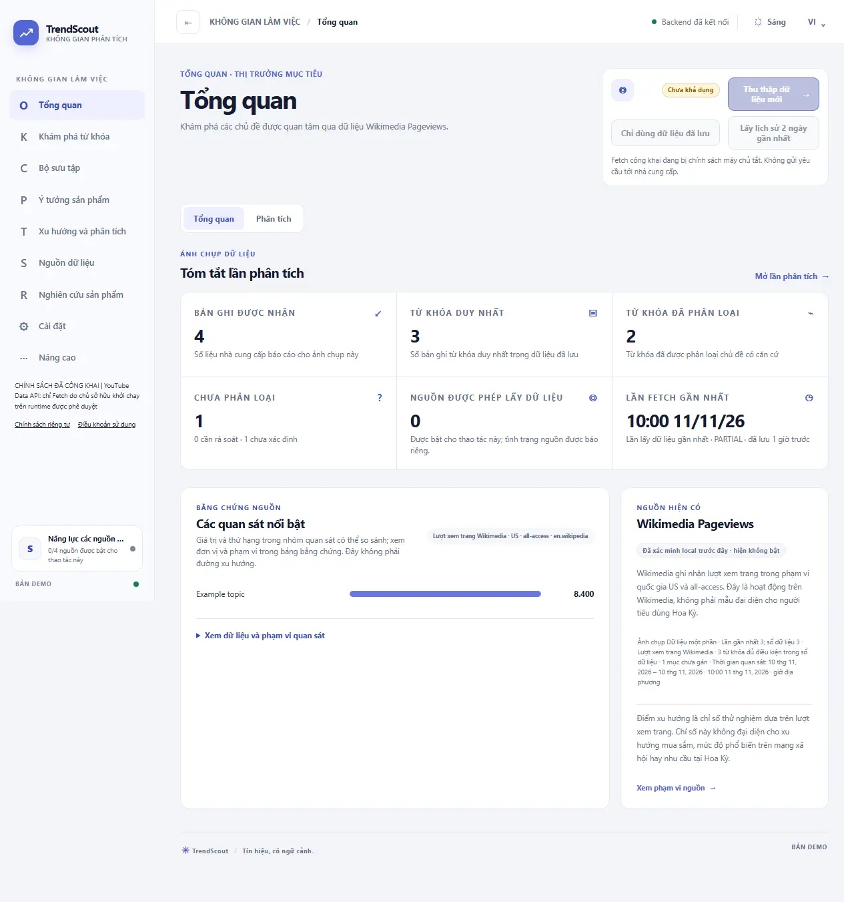
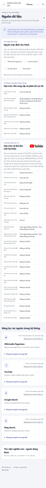
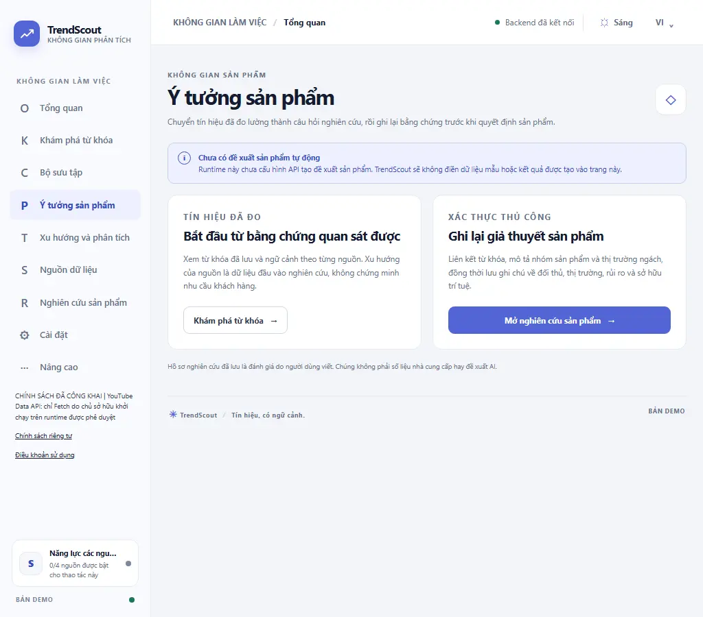
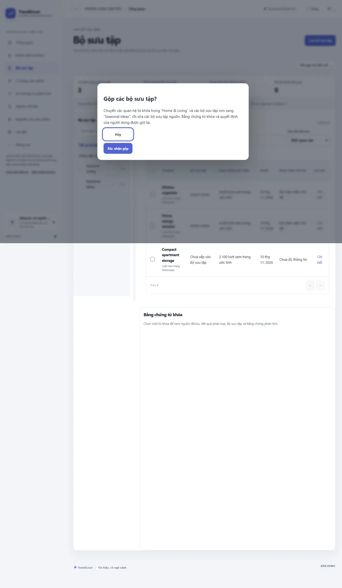

# TrendScout UI overhaul report

- **Status:** Local implementation in review on `feature/ui-overhaul`
- **Date:** 26 November 2026
- **Baseline:** `cf09b2e`
- **Verification:** Offline fixtures only; no provider calls, AI quota, or deployment

## Summary

The UI now has clean user-facing paths, a compact eight-link primary navigation, localized light/dark VI/EN behavior, a registry-driven Source Center and source filter, explainable saved-keyword/Collection flows, and truthful states for unsupported product recommendations and inactive retention cleanup. Fetch outcomes remain source-scoped, partial outcomes stay partial, and progress uses backend counts rather than its percentage field. The interface does not claim a market signal beyond the evidence and scope returned by a source.

This is a frontend integration change, not a product/data-source approval. The current runtime source catalog is the authority for active capabilities. The separate source-research catalog is not presented as connected sources.

## Reference feature audit

The reference website was not usable as an implementation input during the earlier audit; its source repository's `template.html`, `HUONG_DAN.md`, and named sections were reviewed for feature ideas. No reference CSS/layout, website data, or unsupported scoring algorithm was copied.

| Reference area | TrendScout treatment |
| --- | --- |
| Overview | Overview and Trends share the saved-data/analytics experience; filters and source scope remain attached to their actual API response |
| Topics | Keywords and Collections provide search, filter, pagination, user assignments, saved suggestions, and preview before proposal actions |
| History | Run History shows reported receipt/source outcomes and a retention note that states the policy target without claiming active cleanup |
| Ideas, Niches, Domains | Product Ideas gives an explicit automated-recommendation unavailable state and routes to saved evidence and user-authored Research |
| Social, Feed | Source Center separates the runtime registry from the research inventory; unimplemented candidates are not shown as live feeds |

## Navigation and routes

Primary navigation: Overview `/`, Keywords `/keywords`, Collections `/collections`, Product Ideas `/products`, Trends `/trends`, Sources `/sources`, Research `/research`, Settings `/settings`. Advanced navigation: Run History `/runs`, Algorithms `/algorithms`, Data Quality `/quality`.

Deep links include `/collections/{id}` and `/sources/{source_id}`. `/trends` opens the analysis tab. Legacy hashes migrate to clean paths while preserving query parameters; `/dashboard`, `/dashboard/`, and `/dashboard/{path}` redirect backward. `/privacy` and `/terms` alias the existing published policy files without changing policy wording. The shared Vercel install command from the Database Goal is preserved.

Detailed paths and service contracts are recorded in [UI_CONTRACT.md](../Integration/UI_CONTRACT.md). Vercel's documented filesystem precedence, redirect-before-rewrite ordering, and route order were reviewed against [Vercel project configuration](https://vercel.com/docs/project-configuration/vercel-json) and [rewrite routing](https://vercel.com/docs/routing/rewrites) on 26 November 2026. These docs do not prove deployed routes are active.

## UX changes

- **Responsive shell and accessibility:** Light theme and Vietnamese default; English and dark theme persist; compact mobile navigation, skip link, route-aware `aria-current`, focus restoration for drawers/dialogs, and reduced-motion CSS remain available.
- **Overview and Trends:** Saved-keyword source, topic category, Collection, date, classification, evidence, status, query, and sort filters use backend-supported fields. Topic-category filtering comes from saved Collection taxonomy; no independent industry or market-size API exists. Source/time controls without supported data remain disabled with an explanation.
- **Sources:** Source cards are built from runtime capability descriptors, link to reloadable detail paths, and keep technical details expandable. Unknown registry IDs get a neutral monogram fallback. The overview source filter also uses the capability registry rather than four hard-coded IDs.
- **Fetch:** Per-source status, supported counts, known error summary, retry/recovery status, and expandable diagnostics. The UI never uses the API `percent` field and does not claim save, algorithm, or AI progress stages that the endpoint does not report. It does not auto-submit on reload.
- **Keywords and Collections:** Collection selection has a clean path. Proposal name/description can be edited before acceptance within API length limits; the UI lazily previews at most five saved supporting keywords and requires explicit accept/reject actions. Search, pagination, bulk actions, Collection CRUD, merge review, and existing reclassification stay separate from Fetch.
- **Product and Research:** Product Ideas explains that automated recommendation capability is unavailable in this branch. Research records remain explicit user-authored hypotheses, not generated market truth.
- **Algorithms:** Registry intent, input metric/unit, minimum samples, source compatibility, limitations, and actual stored result states are visible; empty/skipped results are not shown as successful runs.
- **History:** The rolling seven-local-calendar-day target is described as a contract target. The UI does not assert runtime cleanup is active and does not remove user-authored records.

## API dependencies and gaps

The UI consumes existing same-origin APIs: capabilities/source library; dashboard bootstrap and saved keyword pages; analytics; Collections, proposal accept/reject, and reclassification; fetch submit/status/history; Research bootstrap/list/create/update; algorithm catalog/results; and run-history list/detail. Limits, statuses, field names, and response caveats are in the UI contract.

The current Collection suggestion API supports the proposal editor; it does not prove that every suggestion was produced by the AI goal. The AI goal's separate v1.1-draft contract describes `/api/v1/ai/...` endpoints from its parallel worktree; those routes are not in this UI branch and are not called. Product recommendation APIs are also absent from this UI branch. No Algorithms integration contract was present in the Algorithms worktree at the review point; the existing registry/results endpoints are documented without declaring their methods approved.

The read-only Database contract (26 November 2026) specifies a rolling window of dates D−6 through D in `Asia/Ho_Chi_Minh`, with shorter provider retention winning and ambiguous lineage retained. It also says migration versions 1–9 are in the Neon target while the 35 non-ledger business/operational tables remain empty and cutover is not ready. These facts inform truthful UI copy; no database cleanup or cutover was changed here.

## Source assets and attribution

The source-mark registry is centralized in `Frontend/public/modules/source-brand.js`. Runtime cards and Fetch rows use simple local monograms; unknown sources use a generic bullet. The existing local `Frontend/public/assets/youtube-logo.svg` remains restricted to the linked YouTube evidence section. The branch added no provider logo downloads or hotlinked logo URLs. No matching asset origin/license entry was found in `Frontend/public/licenses`; verify its provenance before expanding its use. See the official [YouTube API branding guidelines](https://developers.google.com/youtube/terms/branding-guidelines), reviewed 26 November 2026.

## Screenshots

Four representative review images are committed under `evidence/`. The full 271-image matrix was generated for offline layout checks, then removed as temporary QA output.

## Offline verification

The browser checks use injected local API fixtures over loopback or the project's synthetic ASGI test app. Dedicated Fetch E2Es exercise only those fixtures; the workspace navigation/editing flow makes no Fetch submission. No external provider, production API, or AI quota was contacted.

| Check | Evidence / result |
| --- | --- |
| Frontend Node tests | `node --test Frontend/tests`: 71/71 passed, including clean routes, fetch progress validation, idempotent recovery, and GET coalescing/cache behavior |
| Workspace browser workflow | `browser_workspace_offline.py`: six widths (320, 390, 768, 1024, 1440, 1920 px); VI/EN, light/dark, clean-route navigation/history, five runtime source descriptors, Collection CRUD/bulk and editable proposal flow, Research, XSS, overflow; no Fetch submission |
| Visual browser matrix | `browser_d2_visual_offline.py`: Overview plus ten workspace views at six widths, VI/EN and light/dark; no horizontal overflow or console errors; merge dialogs, direct `/sources/google_web_serp` deep link and reload passed |
| Keyboard and accessibility | `browser_keyboard_offline.py` and `browser_g5_run_history_accessibility_offline.py` passed: mobile navigation Tab order, Collection create/edit/delete keyboard flows, focus restoration, dialog Escape behavior, Run History accessible region name/focus, and live relocalization |
| Fetch browser workflows | `browser_distributed_fetch_e2e_offline.py`, `browser_public_fetch_e2e_offline.py`, `browser_google_fetch_selection_offline.py`, `browser_vercel_shared_fetch_e2e_offline.py`, `browser_pipeline_e2e_offline.py`, and `browser_wikimedia_synthetic_e2e_offline.py` passed with local fixtures: duplicate-submit guard, source selection, status/recovery, same-key continuations, cached snapshot reuse, keyword detail, and offline pipeline rendering. The synthetic Wikimedia flow used one `MockTransport` request and 34 browser assertions; its two bounded POSTs were one enqueue plus one continuation with the same idempotency key, and reload sent no further request |
| Backend and workspace unit tests | `test_frontend.py`: 2 passed; `test_smart_collections.py`: 38 passed; `test_vercel_readonly.py`: 10 passed; `test_workspace_ui.py`: 6 passed, using a temporary QA environment with the declared Backend dependencies |
| Performance evidence | Existing Node checks confirm identical concurrent reads coalesce, writes invalidate cached reads, first Overview uses one bootstrap request, and status retry/continuation loops are bounded. No millisecond transition benchmark was collected |
| Provider / deployment | Production/provider calls and deployment were intentionally not run; no live quota or Vercel routing claim is made |

Screenshots, browser tests, and fixture values demonstrate local UI behavior only. They do not prove credentials, provider reachability, actual API quotas, deployed Vercel routing, retention execution, or AI/model quality.

## Handoff and remaining integration work

- Confirm the existing YouTube SVG's origin/license metadata.
- When the AI branch API is integrated, review proposal provenance, model processing/error/quota states, and product recommendation APIs before enabling related actions.
- Add/align an Algorithms contract before claiming algorithm semantics or thresholds have been approved.
- Reconcile the Database contract and verify actual storage population, lineage, retention scheduling, and cleanup audit results before describing cleanup as active.
- Verify Vercel direct-path rewrites and legacy redirects in an authorized preview after deployment approval; no deployment was performed for this work.

## Goal gate status

U1–U8 implementation and contract boundaries are represented above. U9 offline/browser verification is complete; all listed fixtures passed and no live provider was called. U10 contract/report content is ready; branch-only commit and push remain the final handoff steps. No merge to `main` or production deploy is part of this handoff.
