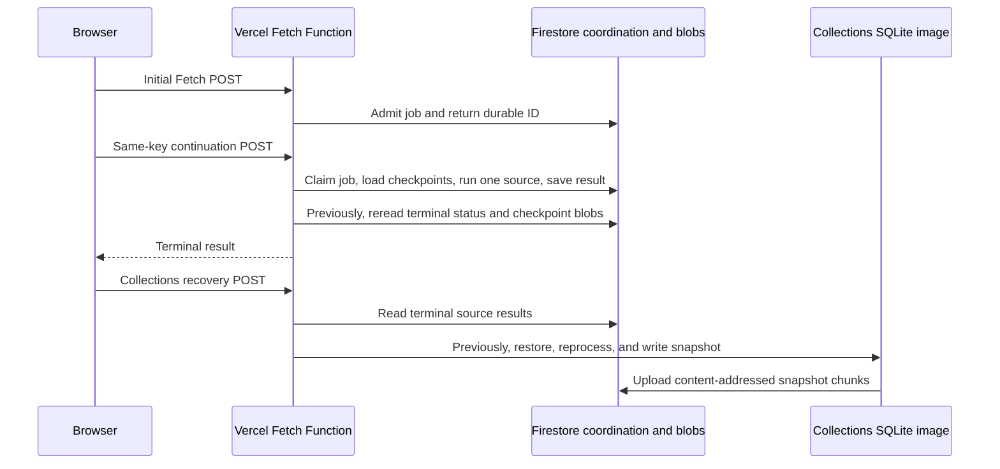

# Vercel Shared LIVE Performance and Scaling Report

**Status:** Implementation and consolidated offline verification complete; release acceptance pending.
**Updated:** 25 November 2026
**Baseline revision:** `4c02c718b6177bc04aa4ab1b5069886236b620c5`
**Baseline production deployment:** `dpl_HKevZoBtmXC4xJxevvUQpvWSQ33k`
**Production alias:** `https://trend-scout-mu.vercel.app/`

This report records targeted changes to the existing Vercel Shared LIVE path. It does not approve a new product architecture or make a claim that the whole application has been load-tested. Baseline timings are measurements from the existing production deployment; expected changes below are structural until the new deployment has been checked.

## Scope and constraints

- Reduce repeated Firestore reads, checkpoint transactions, immutable blob writes, SQLite snapshot restoration, duplicate Collections analysis, and terminal response latency on the existing Shared LIVE path.
- Preserve provider-call counts, source records, data mode, observation times, source scope, retention rules, public response safety, and the existing 120-second function cap in `Backend/vercel.json`.
- Use only existing Vercel, Firestore, and application resources. No new service, dependency, plan, paid feature, provider permission, or data migration is introduced.
- Do not make a Production LIVE Fetch for this acceptance. Production verification is limited to read-only routes and deployment/runtime inspection. The cache-only Fetch path is eligible only if zero provider requests are guaranteed; it is not required for this release.

## Baseline measurements

The pre-change observations below were collected from the baseline deployment. Request wall time includes application work and external waits; it is not a direct measurement of billed active CPU.

| Operation or component | Baseline observation |
| --- | ---: |
| Initial Fetch admission POST | 7.933 s |
| Cached continuation POST | 76.748 s |
| Terminal Fetch status GET after continuation | 11.832 s |
| Source checkpoint load | 1.84–2.08 s per source |
| Source handler | 1.84–8.74 s |
| Source checkpoint save | 2.05–11.24 s |
| Collections database image | 72.6 MB |
| Compressed Collections snapshot | 6.75 MB |
| Snapshot save | 44 s, including 40.4 s upload |
| Collections processing request | 69.2 s |
| Read APIs | Several seconds per request |

The project function is currently capped at 120 seconds. Vercel documents `maxDuration` as the maximum function execution duration and states that the function is terminated when the configured maximum is exceeded ([Vercel function duration configuration](https://vercel.com/docs/functions/configuring-functions/duration), checked 25 November 2026). At the measured 76.748-second continuation baseline, the nominal margin to this project cap was about 43.3 seconds. No duration, memory, or region setting was changed.

The exact Firestore region was not confirmed during baseline inspection and remains unchanged. Source/provider limits, actual Vercel credentials, and production provider reachability are outside this report's verification.

## Request path and bottlenecks

The dominant repeated-run cost was work after source delivery: another terminal status read, repeated checkpoint coordination transactions, full Collections restoration and analysis, and re-upload of unchanged snapshot bytes. The slow first Collections build remains a different case: when source evidence is new, it still needs to run the established processing and persistence path.

## Implemented changes

1. **Terminal response from the active worker.** The completed continuation builds its terminal public projection from the already validated worker result, avoiding the follow-up terminal status read and checkpoint blob reads. It retains normal status projections, source time/coverage fields, discovery output, and YouTube's existing public record projection. The ordinary status route remains the fallback when a projection cannot be built.
2. **Skip discovery in Collections recovery.** Fetch processing and recovery request the source result projection without computing discovery that the Collections path does not use.
3. **Exact cache-only Collections reuse.** A versioned SHA-256 digest covers each source's status, mode, count, quality/error fields, stable coverage and normalized records. Only transient delivery markers/counters are excluded. Reuse requires a completed prior dataset, the same complete source set, LIVE/CACHED delivery, valid record counts, zero provider requests in both the source result and coverage when reported, matching digests, and non-empty scope coverage. Fresh, stale, unavailable, partial-incomplete, changed-scope, changed-record, or malformed evidence continues through normal processing. `MODEL_UNAVAILABLE` remains retryable.
4. **One-time legacy backfill.** Older dataset manifests have no input digest. Their first matching cache-only recovery will process and persist once to record digests; a later exact match can reuse that dataset. No database migration is needed because the digest is an additive source-manifest field.
5. **Avoid redundant SQLite restoration.** Deferred Shared LIVE requests read the latest dataset summary from the existing Firestore snapshot pointer. Public dataset and analytics responses remove internal digest fields before returning manifests.
6. **Read-only immutable cache hits.** Vercel Shared LIVE cache reads use Firestore's existing batch read when the admission clock is monotonic and the record would remain unchanged apart from `last_checked_at`. Expiry, malformed state, time regression, or retention tightening keeps the transactional path.
7. **Checkpoint claim snapshot reuse.** Source checkpoint loads use the already fenced checkpoint snapshot returned by the claim transaction when the grant and retention are unchanged. Retention shortening and other invalidating cases still use the owned transaction.
8. **Content-addressed blob reuse.** An active identical snapshot blob is not rewritten. Retention extension updates only the manifest/chunk retention fields atomically; expired content is rewritten. Reads continue to validate every chunk and its retention against the manifest.
9. **Browser no-op recovery.** When the backend confirms that the latest cached source evidence already matches the saved dataset, the UI loads saved dataset metadata if needed and skips Collections job polling, duplicate recovery, and analytics refresh.

The production workflow, source selection, provider adapters, request budgets, retention policy, and Vercel project configuration are unchanged. No provider request was added by these code changes.

## Correctness and acceptance checklist

- [x] Consolidated offline verification passes for the touched backend, storage, API, and browser paths.
- [ ] Exact matching LIVE/CACHED evidence can reuse only a completed LIVE dataset and reports the saved dataset ID.
- [ ] Any changed source scope or record content, non-zero/conflicting provider request count, stale result, malformed digest, incomplete source set, or unavailable processing result falls back or fails closed.
- [ ] Existing source observation times and provider request counts remain unchanged by cache delivery; the established four-source/FRESH-to-CACHED acceptance contract remains intact.
- [ ] Internal source digests are absent from public Fetch history, analytics, run detail, and latest dataset manifests.
- [ ] Changes are committed and pushed to `origin/main`; Vercel Production is READY on the pushed revision and the production alias serves the deployment.
- [ ] Production read-only checks complete for capabilities, latest dataset, run history, analytics overview, and runtime/deployment status, with status codes and request timings recorded below.
- [ ] No Production LIVE Fetch or provider-call acceptance is performed.
- [ ] If cache-only Production acceptance is attempted, it is preceded by a verified zero-provider-call condition; otherwise it remains explicitly not run.

## Verification and release record

### Consolidated offline verification

**Passed 25 November 2026.** One consolidated PowerShell run completed:

- Ruff passed on every changed Python application and test file.
- Backend focused suites passed: `test_d5_distributed_worker.py` (35), `test_d5_firestore_shared_cache.py` (29), `test_smart_collections.py` (36), `test_keyword_workbench.py` (26), `test_vercel_shared_live_fetch.py` (34), and `test_public_fetch.py` (15): **175 tests passed**.
- `browser_vercel_shared_fetch_e2e_offline.py`: **PASS**; unchanged cached evidence loads the saved dataset without analytics refresh or Collections polling.
- Frontend `node --test tests/*.test.mjs`: **55 passed, 0 failed**.
- `git diff --check`: **PASS**.
- Node printed its existing experimental `localStorage` warning; it did not affect the suite.

These are offline/fake-provider checks. They do not establish live Firestore latency, provider reachability, or a production end-to-end timing improvement.

### Deployment and read-only production acceptance

**Pending.** Record the pushed commit, production deployment ID/status, alias check, and GET-only acceptance endpoints/timings here. No live provider acceptance is authorized by this plan.

## Risks and limits

- A fresh source result still requires the established Collections processing and snapshot commit. The measured 69.2-second Collections request and 44-second snapshot save are not claimed to be optimized for a first fresh build.
- The first cache-only run against a legacy dataset without digests must process once. The saved digest then enables later no-change reuse.
- A cache mismatch intentionally causes a false negative (extra processing) rather than risk reusing a dataset built from different inputs.
- The report has no post-change live Fetch timing because Production LIVE Fetch testing is prohibited. Offline tests establish behavior and work-count reductions, not production latency or throughput.
- The current 120-second Vercel function cap and current Firestore region remain as configured; this work does not claim an increased capacity limit or a specific regional latency improvement.
- Vercel's current pricing documentation distinguishes active CPU and provisioned-memory usage on Fluid Compute; wall-clock timings here are not converted into a cost estimate ([Vercel Fluid Compute pricing](https://vercel.com/docs/functions/usage-and-pricing), checked 25 November 2026).
