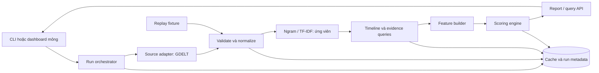

# Trend Keyword Demo — Phân tích nghiệp vụ và thiết kế hệ thống

**Ngày lập:** 09/11/2026. **Trạng thái:** bản đề xuất để khởi tạo dự án mới, chưa phải thiết kế được phê duyệt hay hệ thống đã triển khai.

“BS” được tạm hiểu là **Business — mức nghiệp vụ**. Tài liệu gồm phần A cho BA/người đánh giá và phần B cho dev. Đây là thiết kế mới theo mục tiêu demo, không yêu cầu kế thừa toàn bộ TrendScout cũ.

**Kết luận đề xuất:** làm một pipeline Python độc lập, dùng **GDELT DOC API với bộ lọc nguồn báo Mỹ** làm nguồn đầu tiên; trích xuất ứng viên bằng ngram/TF-IDF, chấm bằng tăng trưởng tương đối và robust z-score, trình bày điểm cùng bằng chứng. Web dashboard và fetch thủ công là lớp trình bày tiếp theo nếu core pipeline hoàn thành đúng hạn.

GDELT đo **xu hướng tin tức**, không đại diện cho mức viral của toàn bộ mạng xã hội Mỹ. Nếu yêu cầu bắt buộc là bài đăng social, ưu tiên khảo sát adapter Bluesky riêng và giữ nhãn địa lý chưa xác minh. Không trộn hai loại tín hiệu vào một điểm khi chưa kiểm chứng.

## A. Phân tích mức nghiệp vụ

### A1. Mục tiêu và ranh giới

**Bài toán:** với một nhóm chủ đề hoặc keyword đầu vào, hệ thống lấy dữ liệu mới từ API, chuẩn hóa, xác định keyword có sự chú ý đang tăng, rồi giải thích tại sao keyword được xếp hạng đó.

**Đầu ra tối thiểu:** danh sách keyword, điểm 0–100, trạng thái xu hướng, mức đủ dữ liệu, cửa sổ so sánh và link bằng chứng. Điểm là **chỉ số do demo định nghĩa**, không phải xác suất keyword thật sự là trend, điểm của nhà cung cấp hay dự báo doanh số.

| Phạm vi | Nội dung |
|---|---|
| MVP bắt buộc | Một API thật; pipeline fetch → validate → normalize → keyword extraction → feature calculation → scoring → báo cáo JSON/bảng kết quả |
| Lớp trình bày nếu kịp | Web dashboard nhỏ, nút fetch thủ công, tìm keyword trong kết quả và nút phân tích keyword cụ thể |
| Để sau | Gợi ý sản phẩm, research sản phẩm, multi-source scoring, cảnh báo tự động, ML có giám sát, phân quyền nhiều người dùng |
| Không đặt làm mục tiêu tuần này | Chứng minh độ chính xác trên toàn thị trường Mỹ; thu thập toàn bộ social; realtime/firehose; hệ thống production |

**Đối tượng demo:** một người vận hành/phân tích và người xem kết quả. Chưa cần xây quản lý tổ chức/tài khoản đầy đủ.

**Điều kiện thành công:** chứng minh được dữ liệu đi xuyên suốt pipeline, điểm được tính có quy tắc và tái lập, keyword có đà tăng khác keyword chỉ có lượng nhắc cao, và hệ thống thể hiện đúng khi dữ liệu không đủ.

### A2. Định nghĩa “trend” để nghiệm thu

Trong demo, một keyword là **ứng viên xu hướng đang lên trong phạm vi nguồn/chủ đề được chọn** khi:

1. Tỷ trọng tin nhắc đến keyword ở cửa sổ gần nhất tăng so với baseline trước đó.
2. Mức tăng đủ lớn để không chỉ là dao động rất nhỏ.
3. Có đủ số tin và nhiều domain xuất bản để tránh kết luận từ một bài đơn lẻ.
4. Dữ liệu so sánh hợp lệ, cùng nguồn, cùng bộ lọc và cùng độ dài cửa sổ.

Các nhãn đề xuất:

| Nhãn hiển thị | Ý nghĩa |
|---|---|
| Chưa đủ dữ liệu | Thiếu baseline, cửa sổ lỗi, thiếu mẫu số hoặc dữ liệu không còn dùng được |
| Ít bằng chứng | Có phép tính, nhưng số tin hoặc độ đa dạng nguồn chưa đạt ngưỡng |
| Bình thường/ổn định | Có độ chú ý nhưng chưa thấy tăng đủ mạnh |
| Đang nổi | Đạt ngưỡng tăng và điểm ở mức trung bình |
| Ứng viên trend | Đạt các điều kiện tối thiểu và ngưỡng điểm cao |
| Đang giảm | Tỷ trọng hiện tại giảm rõ so với baseline |

“Keyword nhiều người nhắc”, “keyword mới” và “keyword đang tăng” là ba khái niệm khác nhau. Tìm thấy một keyword lần đầu trong dữ liệu không tự chứng minh keyword mới xuất hiện ngoài thị trường.

### A3. Các mạng xã hội đáng quan tâm tại Mỹ

Số liệu dưới đây là tỷ lệ người trưởng thành Mỹ nói **có sử dụng**, không phải DAU/MAU hoặc tốc độ tăng trưởng. Pew công bố ngày **19/10/2026**, khảo sát 5.511 người từ 30/01–18/06/2026. [Nguồn Pew Research Center](https://www.pewresearch.org/internet/fact-sheet/social-media/).

| Nền tảng | Tỷ lệ người lớn Mỹ năm 2026 | Nhận định sử dụng cho bài toán — đề xuất của tài liệu |
|---|---:|---|
| YouTube | 84% | Độ phủ rộng; đáng nghiên cứu video/chủ đề, nhưng cần kiểm tra quyền tạo chỉ số từ API |
| Facebook | 70% | Đáng quan tâm về độ phủ; không giả định có API đọc toàn bộ bài công khai |
| Instagram | 51% | Phù hợp quan sát nội dung hình ảnh/creator; quyền truy cập là việc cần giải quyết riêng |
| TikTok | 37% | Đáng quan tâm nếu hướng nội dung ngắn và người trẻ |
| WhatsApp | 33% | Độ phủ lớn không đồng nghĩa có dữ liệu hội thoại công khai để phân tích |
| LinkedIn | 31% | Có thể cân nhắc nếu chuyển sang ngành nghề/B2B |
| Snapchat | 26% | Cần xem theo nhóm người dùng mục tiêu, không ưu tiên API cho demo này |
| Reddit | 25% | Nội dung cộng đồng có thể hữu ích; quyền API hiện là rủi ro thời gian |
| X | 18% | Có thể hữu ích theo sự kiện, nhưng chi phí API cần dự trù |

Không có số Bluesky 2026 trong bảng Pew này; **4% là số 2025**, không gắn nhãn thành số 2026. “Hot” về độ phủ người dùng và “thuận tiện để lấy dữ liệu” phải đánh giá riêng. Từ số liệu trên, nhóm đáng khảo sát nghiệp vụ trước là YouTube, Facebook, Instagram và TikTok; lựa chọn nguồn cho demo còn phụ thuộc API.

### A4. Chọn API nào?

#### A4.1. So sánh theo khả năng làm demo trong một tuần

| Nguồn/API | Điểm thuận lợi | Hạn chế quyết định | Đề xuất |
|---|---|---|---|
| **GDELT DOC** | Có danh sách bài và timeline; lọc nước của nguồn báo; không có bước OAuth trong request được tài liệu hóa | Là news, có giới hạn/trễ/rate limit; không đo người dùng social | **Nguồn mặc định cho core demo**, phải qua kiểm chứng truy cập ngày đầu |
| **Bluesky public API** | Có API công khai, nội dung ngắn thuận tiện khai phá keyword | Không có bảo đảm tác giả/người xem ở Mỹ; endpoint hiện thử bị 403 | Adapter social dự phòng/phiên bản kế tiếp, chưa cam kết live |
| **YouTube Data API** | API chính thức, metadata video, có tham số vùng | Ràng buộc derived metrics; `mostPopular` có phạm vi nội dung riêng | Chưa chọn cho thuật toán điểm tùy biến của demo |
| **TikTok Research API** | Dữ liệu public phục vụ nghiên cứu | Có điều kiện tổ chức/nghiên cứu và xét quyền truy cập | Không đặt vào critical path tuần này |
| **Reddit** | Có cộng đồng theo chủ đề | Access/app review; khả năng được cấp quyền chưa xác định | Chỉ xem tiếp khi đã có quyền phù hợp |
| **X API** | Có truy vấn bài đăng | Pay-per-use; không phù hợp mục tiêu mặc định không chi phí | Để sau |
| **Instagram/Facebook** | Phù hợp bối cảnh người dùng Mỹ | Không xem là nguồn search toàn mạng sẵn dùng; phải xác định sản phẩm API và quyền cụ thể | Không mở thêm tích hợp trong tuần demo |

Nguồn kiểm chứng: [GDELT DOC](https://blog.gdeltproject.org/gdelt-doc-2-0-api-debuts/), [Bluesky API hosts/auth](https://bsky.network/docs/api-directory/), [TikTok Research Tools](https://developers.tiktok.com/products/research-api/), [Reddit developer access](https://support.reddithelp.com/hc/en-us/articles/14945211791892-Developer-Platform-Accessing-Reddit-Data), [X pricing](https://docs.x.com/x-api/getting-started/pricing). Các đánh giá ưu tiên là suy luận thiết kế cho thời hạn này, không phải xếp hạng chất lượng các nền tảng.

#### A4.2. Ba lưu ý quan trọng về YouTube

- Chính sách III.E.4.h hạn chế tạo dữ liệu/chỉ số phát sinh từ API; mục III.L mô tả ngoại lệ cho developer đã audit và được cấp quyền analytics. Vì vậy không giả định được tự do tính trend score từ view/like. Đây là lý do không chọn làm mặc định. [YouTube Developer Policies](https://developers.google.com/youtube/terms/developer-policies).
- `search.list regionCode=US` chỉ lọc video có thể xem tại Mỹ, không chứng minh lượt xem đến từ người Mỹ. [Search API](https://developers.google.com/youtube/data/reference/rest/v3/search/list).
- Từ 21/07/2025, `mostPopular` chuyển sang nội dung chart Music, Movies, Gaming; không coi là bảng trend toàn chủ đề. Quota mặc định hiện được tài liệu hóa riêng cho search và các endpoint khác, nên không dùng các con số quota cũ nếu tích hợp sau này. [Revision history](https://developers.google.com/youtube/data/revision_history), [API overview](https://developers.google.com/youtube/data/getting-started).

#### A4.3. Kết quả kiểm chứng truy cập ban đầu

Ngày 09/11/2026, từ môi trường làm tài liệu:

- Một request GDELT ArtList nhỏ trả **HTTP 429**.
- Một request Bluesky search nhỏ qua public host trả **HTTP 403**.
- Không thu thập tập dữ liệu chạy ứng dụng; đây chỉ là kiểm tra khả năng kết nối. Chưa đủ bằng chứng kết luận dịch vụ lỗi toàn cầu, không dùng được từ host khác hoặc đã sẵn sàng cho demo.

**Cổng kiểm chứng ngày đầu:** từ máy chạy/host dự kiến, lấy thành công ArtList và TimelineVolRaw hợp lệ; xác nhận cách biểu diễn bucket 0/missing, timestamp, denominator và giới hạn. Chưa qua cổng này thì giữ API là lựa chọn dự kiến, không ghi là tích hợp hoàn tất.

### A5. User story và requirement

| ID | Nhu cầu | Điều kiện hoàn thành quan sát được |
|---|---|---|
| FR-01 | Người vận hành chọn một profile chủ đề | Profile lưu seed query, source scope US, language, khoảng thời gian và version |
| FR-02 | Fetch dữ liệu theo yêu cầu | Một thao tác tạo một run có trạng thái, giờ bắt đầu/kết thúc và số lượng request/bản ghi |
| FR-03 | Chuẩn hóa dữ liệu | Bản ghi hợp lệ có schema chung; bản lỗi được thống kê với lý do, không âm thầm biến thành tin hợp lệ |
| FR-04 | Tự đề xuất keyword | Sinh danh sách ứng viên từ title, loại stopword/rác, giữ link về bài nguồn |
| FR-05 | Tính điểm xu hướng | Keyword có đủ dữ liệu trả điểm hữu hạn 0–100, feature và version công thức; thiếu baseline trả điểm null |
| FR-06 | Giải thích kết quả | Thấy cửa sổ, current/baseline, tỷ lệ tăng, số tin, domain bằng chứng và giới hạn mẫu |
| FR-07 | Phân tích keyword nhập tay | Chấp nhận phrase tiếng Anh hợp lệ; dùng cùng source/profile/time window như bảng xếp hạng |
| FR-08 | Chạy lại không đếm lặp | Cùng đầu vào chuẩn hóa, cutoff và version cho cùng kết quả; cùng bài không nhân số lượng do fetch lại |
| FR-09 | Xử lý API lỗi hoặc dữ liệu cũ | Có lỗi/partial/stale rõ ràng; không cập nhật nhãn “vừa fetch” cho dữ liệu cũ |
| FR-10 | Replay phục vụ thuyết trình | Có thể chạy pipeline trên fixture/snapshot cho phép lưu, gắn nhãn REPLAY/SYNTHETIC rõ ràng |

Nếu làm lớp web: cần xem bảng xếp hạng, chi tiết keyword, lọc kết quả local và nút fetch/analyze. Không gọi API theo từng ký tự gõ; tìm local và phân tích từ API là hai hành động riêng.

### A6. Điều kiện nghiệm thu và đánh giá thuật toán

| ID | Kịch bản/tiêu chí |
|---|---|
| AC-01 | Ít nhất một run **live** đi qua API → chuẩn hóa → feature → điểm; có request metadata và nguồn kiểm tra được |
| AC-02 | Tập dữ liệu giả lập có keyword tăng mạnh được xếp trên keyword ổn định có lượng nhắc lớn; trọng số và đầu vào cố định |
| AC-03 | Trường hợp 0→1 bài không được gắn “ứng viên trend”; volume thấp bị chặn bởi điều kiện hỗ trợ |
| AC-04 | Thiếu baseline/denominator hoặc upstream lỗi không tạo score bằng 0 để giả làm “không trend”; score trả null và lý do |
| AC-05 | Thêm cùng bài nhiều lần không làm tăng document frequency trong phần discovery/evidence sau dedup |
| AC-06 | Cùng snapshot, cấu hình, cutoff và phiên bản công thức cho kết quả tái lập; chạy lại không bị giờ hệ thống làm đổi feature |
| AC-07 | Khi tăng tổng tin nền gấp đôi và giữ nguyên tỷ trọng keyword, chỉ số growth không tăng chỉ do nguồn nhiều tin hơn |
| AC-08 | Khi API trả 429/403/timeout, run phản ánh đúng lỗi/partial và kết quả tốt trước đó vẫn nhận biết được là cũ |
| AC-09 | Người xem mở được bằng chứng, hiểu điểm là chỉ số demo và hiểu “US” là phạm vi nguồn báo |
| AC-10 | Replay vẫn trình diễn được khi mất mạng, đồng thời không được tính là đã đạt AC-01 |

**Đánh giá phù hợp tuần demo:** so sánh baseline “xếp theo số tin hiện tại” với công thức đề xuất trên cùng tập replay; dùng 6–10 tình huống kiểm soát: tăng thật, ổn định, giảm, một nguồn spam, lượng thấp, mất bucket, nền tăng, đổi bộ lọc. Nếu có dữ liệu live, review thủ công top 10 và ghi “hợp lý/chưa hợp lý/không đủ bằng chứng”.

Precision@10 trên đánh giá thủ công chỉ là chỉ báo của tập đánh giá nhỏ, không phải độ chính xác toàn thị trường. Không đặt cam kết “90% chính xác” khi chưa có nhãn chuẩn, thời gian quan sát và đánh giá ngoài mẫu.

## B. Thiết kế mức hệ thống

### B1. Kiến trúc đề xuất



**Nguyên tắc tách lớp:** core phân tích không phụ thuộc web framework. Collector không chứa công thức điểm; scorer không gọi mạng; UI không tự tính lại một công thức khác. Có thể hoàn thành demo CLI trước rồi gắn web mà không viết lại thuật toán.

Một nguồn trước, một profile chủ đề mỗi run, tối đa 10 ứng viên cần timeline. Không xây microservice, Kafka, Redis, Celery hay vector database trong tuần này.

### B2. API contract và cách thu thập

Endpoint dự kiến: `GET https://api.gdeltproject.org/api/v2/doc/doc`.

Các khả năng cần dùng: ArtList cho title/link; `sourcecountry:US` và `sourcelang:english`; TimelineVolRaw cho count theo thời gian; mốc bắt đầu/kết thúc cố định. ArtList tối đa 250 dòng; timeline raw có `norm` là tổng tin **toàn cầu**, không phải tổng tin Mỹ. [Tài liệu API chính thức](https://blog.gdeltproject.org/gdelt-doc-2-0-api-debuts/).

Ví dụ request dự kiến để kiểm tra ở giai đoạn tích hợp:

```http
GET /api/v2/doc/doc?query=technology%20sourcecountry%3AUS%20sourcelang%3Aenglish&mode=artlist&format=json&maxrecords=250&timespan=1d&sort=datedesc
Host: api.gdeltproject.org
```

**Luồng một run — thiết kế của demo:**

1. Chọn profile hẹp, ví dụ `technology`; cố định `analysis_cutoff` và bộ lọc `B` cho run.
2. Lấy ArtList trong 24h gần cutoff để tạo ứng viên; nếu chạm 250 dòng, đặt `discovery_capped=true`. Đây là mẫu phát hiện ứng viên, không phải toàn bộ corpus.
3. Chuẩn hóa title và sinh tối đa 10 phrase ứng viên. Không dùng số dòng ArtList làm tổng số tin của toàn thị trường.
4. Lấy một timeline count cho `B`, làm denominator cùng phạm vi chủ đề/US/ngôn ngữ.
5. Với mỗi phrase `k`, lấy timeline cho `B AND phrase(k)`. Adapter chuyển biểu thức logic này thành cú pháp query được hỗ trợ; không nối raw query người dùng vào upstream.
6. Xếp shortlist theo phần feature đã có (`0.40G + 0.25Z + 0.15V + 0.10P`), rồi lấy bằng chứng cho tối đa 3 keyword đầu hoặc keyword được chọn; tính số domain từ mẫu bằng chứng, ghi rõ đó là cận dưới quan sát được. Thứ tự shortlist chỉ chọn nơi cần lấy thêm dữ liệu, chưa phải bảng điểm hoàn chỉnh.
7. Ghép bucket, tính feature/điểm. Keyword chưa có đủ bằng chứng được giữ trạng thái provisional; khi bổ sung evidence thì tính lại cùng version và cutoff.

**Phân biệt dữ liệu:** title dùng để discovery; timeline upstream tìm trong corpus của nhà cung cấp. Do đó số bài trong timeline không nhất thiết bằng số title chứa cụm trong danh sách tải về. API không cung cấp toàn văn để hệ thống tự kiểm lại mọi kết quả.

**Định nghĩa US:** vị trí nguồn báo theo metadata nhà cung cấp; không suy thành quốc tịch người viết, nơi diễn ra sự kiện hay nơi cư trú độc giả.

**Budget đề xuất:** tối đa khoảng 15 request thành công/run với 10 ứng viên và 3 evidence queries. Request chạy tuần tự, bắt đầu với khoảng nghỉ 5 giây do ứng dụng tự đặt, không coi đây là quota cam kết của GDELT. Honor `Retry-After`, retry có giới hạn và jitter; dừng ở ngân sách thời gian 180 giây, báo partial nếu chưa đủ.

Cache truy vấn giống nhau 15 phút để tránh fetch lặp. Nếu retry/rate limit làm hết budget, giảm còn 3–5 keyword; không mở thêm nguồn ngay để che lỗi. Không có cam kết upstream luôn trả trong thời gian demo mong muốn.

### B3. Chuẩn hóa dữ liệu

#### B3.1. Schema chung cho bài nguồn

| Trường | Kiểu | Quy tắc |
|---|---|---|
| `source` | string | `gdelt` ở adapter đầu tiên |
| `source_id` | string | Hash URL canonical; giữ URL gốc để đối chiếu |
| `url`, `canonical_url` | string | Chỉ URL http/https hợp lệ; bỏ tracking đã biết, không xóa query có ý nghĩa |
| `title_raw`, `title_normalized` | string | Giữ raw; Unicode NFKC, HTML unescape, chuẩn hóa khoảng trắng ở bản phân tích |
| `publisher_domain` | string | Host chuẩn hóa; domain không đồng nghĩa tổ chức sở hữu độc lập |
| `language`, `source_country` | string/null | Theo provider; không tự gán US nếu metadata không đủ |
| `observed_at`, `fetched_at` | UTC timestamp | Lưu riêng thời điểm nguồn ghi nhận và thời điểm app lấy dữ liệu |
| `time_basis` | enum | Ví dụ `provider_seen_time`; không đổi tên `seendate` thành giờ xuất bản đã xác minh |
| `query_profile_id`, `run_id` | string | Truy vết query/bộ lọc sinh ra bản ghi |
| `quality_flags` | string[] | Missing title, bad URL, unknown time, duplicate, inconsistent metadata… |

Trước khi gắn `time_basis`, spike API phải xác minh ý nghĩa timestamp bằng response thực và tài liệu; dữ liệu không có giờ xuất bản tin cậy không được tự tạo giờ xuất bản giả.

Dedup hai tầng: cùng URL canonical chỉ giữ một bài cho corpus discovery; cùng title/domain gần như trùng gộp thành một nhóm evidence. Giữ liên kết nhiều query đến cùng bài. Không bỏ một bài khỏi ngách sau chỉ vì đã gặp ở ngách trước.

Count của TimelineVolRaw do provider tính; dedup của app trên mẫu title không làm thay đổi hồi tố count upstream. Điều này phải có trong ghi chú kết quả, nhất là khi nhiều báo đăng lại cùng một nội dung.

#### B3.2. Schema chuỗi thời gian

```text
profile_id, keyword_id, bucket_start_utc, bucket_end_utc,
matched_count, background_count, rate,
coverage_status, provider_resolution, query_fingerprint,
fetched_at, time_basis, source
```

- `matched_count` và `background_count` phải cùng query nền, bucket và thời điểm cắt.
- `rate = matched_count / background_count` nếu denominator >0.
- `norm` toàn cầu từ GDELT không thay cho `background_count` của profile Mỹ. Background được hỏi bằng một query riêng.
- Bucket lỗi/thiếu là `null`, không tự biến thành 0. Chỉ ghi 0 khi adapter chứng minh API thể hiện một quan sát không có tin.
- Nếu numerator > denominator hoặc resolution không ghép được, đặt lỗi chất lượng, chưa tính điểm.
- Chỉ cộng counts để đổi resolution; không lấy trung bình các tỷ trọng mà bỏ trọng số denominator.

### B4. Trích xuất keyword: dùng gì, vì sao?

| Phương pháp | Giải quyết việc gì? | Chọn cho demo |
|---|---|---|
| Ngram + document frequency | Sinh cụm 1–3 từ, đếm số title khác nhau có cụm | **Bắt buộc**, đơn giản và dễ giải thích |
| TF-IDF | Giảm vai trò từ quá chung, xếp ứng viên mang thông tin | **Baseline lựa chọn ứng viên**; không dùng riêng để kết luận trend |
| YAKE | Trích keyphrase không cần tập huấn luyện, từ đặc trưng văn bản | Tùy chọn so sánh nếu title/ngram quá nhiễu |
| TextRank/KeyBERT/embedding | Keyphrase/nhóm nghĩa | Để sau; chưa cần tải model hoặc tăng dependency để chứng minh pipeline |

Tài liệu thuật toán/công cụ: [scikit-learn TfidfVectorizer](https://scikit-learn.org/stable/modules/generated/sklearn.feature_extraction.text.TfidfVectorizer.html), [YAKE của nhóm phát triển](https://github.com/INESCTEC/yake). Lựa chọn baseline là quyết định thiết kế cho deadline, chưa phải kết luận TF-IDF tốt nhất trên mọi tập dữ liệu.

Quy tắc đề xuất:

1. Tiếng Anh trước; tokenization có Unicode, giữ phiên bản hiển thị gốc.
2. Bỏ URL, stopword, chuỗi rác, cụm chỉ toàn số; giữ các tên có chữ/số như `GPT-5` theo rule kiểm thử.
3. Dùng ngram 1–3 từ; mỗi phrase đếm tối đa một lần/title.
4. Ứng viên tự khám phá cần xuất hiện trong ít nhất 3 title và 2 domain; keyword nhập tay không bị loại ở bước discovery, nhưng vẫn phải qua điều kiện đủ dữ liệu ở scorer.
5. Bỏ cụm hoàn toàn là seed query nếu nó chỉ lặp điều kiện tìm kiếm. Trong discovery, ưu tiên phrase cụ thể thay vì trả 10 biến thể chứa cùng một từ.
6. Không gộp tự động mọi alias/từ đồng nghĩa. Có thể thêm alias map nhỏ có version; tránh trộn thực thể khác nhau như “Apple” công ty và trái cây.

Trích xuất keyword trả **ứng viên đáng xét**. Chỉ bước phân tích theo thời gian mới trả tín hiệu đang tăng.

### B5. Thuật toán phát hiện xu hướng

#### B5.1. Phương án phù hợp và lộ trình

| Thuật toán | Ưu điểm với bài toán | Hạn chế | Vị trí |
|---|---|---|---|
| Growth trên tỷ trọng | Dễ hiểu, giảm ảnh hưởng tổng lượng tin thay đổi | Dễ bùng khi baseline nhỏ nếu thiếu support gate | Bắt buộc |
| Robust z-score, median/MAD | So mức hiện tại với độ biến động nền, giảm ảnh hưởng một vài outlier | Nền toàn 0 cần floor; không tạo p-value tự động | Bắt buộc |
| EWMA | Theo dõi mức nền có trọng số giảm dần theo thời gian | Phải duy trì trạng thái và kiểm soát chu kỳ/độ trễ | Bản thử nghiệm tiếp theo |
| Kleinberg burst detection | Tìm các giai đoạn bùng nổ và mức burst của dòng sự kiện | Cần chuỗi tốt và chọn tham số chuyển trạng thái | Sau MVP để đối chiếu |
| Prophet/ARIMA/LSTM | Có thể hữu ích khi đã có lịch sử dài và bài toán dự báo rõ | Không phù hợp chỉ vài ngày dữ liệu và deadline này | Không đưa vào demo đầu |

EWMA là kỹ thuật theo dõi chuỗi có trọng số lớn hơn cho dữ liệu gần; Kleinberg mô hình hóa burst bằng chuyển trạng thái. [NIST về EWMA](https://www.itl.nist.gov/div898/handbook/pmc/section3/pmc324.htm), [tài liệu/tình huống của Kleinberg tại Cornell](https://www.cs.cornell.edu/home/kleinber/kdd02.html). Công thức kết hợp ở dưới là **đề xuất riêng của demo**, không phải công thức từ hai nguồn này.

#### B5.2. Cửa sổ thời gian

- Khởi đầu dùng bucket **6 giờ**, chuỗi truy vấn tối đa **7 ngày** kết thúc tại cutoff cố định.
- Để tránh cửa sổ chưa đóng và giảm ảnh hưởng trễ index: `cutoff = floor_6h(now_utc - 2h)`. Độ trễ 2h là giả định thử nghiệm, cần chỉnh theo dữ liệu thật.
- Current là bucket 6h cuối trước cutoff. Baseline lấy tối đa 24 bucket 6h ngay trước current, tối thiểu 12 bucket hợp lệ.
- Spike phải xác nhận API thực sự trả độ phân giải có thể gom 6h. Nếu chỉ có daily thì chuyển toàn bộ chế độ sang daily và dùng profile thuật toán khác; không chia một count ngày thành các count giờ giả.
- Mọi phép so sánh chỉ trong cùng profile/bộ lọc. Thay seed, ngôn ngữ hoặc địa lý làm đổi fingerprint; không ghép lịch sử hai profile khác nhau.

#### B5.3. Feature và công thức v0.1 đề xuất

Ký hiệu: `m_t` = số tin khớp keyword, `n_t` = số tin nền cùng profile, `p_t = m_t/n_t`.

```text
b   = median(p_i của các bucket baseline hợp lệ)
mad = median(abs(p_i - b))
eps = 0.0001
clip(x) = min(1, max(0, x))

G = clip(log2((p_t + eps)/(b + eps)) / 3)
Z = clip((p_t - b) / (6 * max(1.4826 * mad, eps)))
V = clip(m_t / 30)
D = clip(số publisher_domain trong mẫu evidence hiện tại / 5)
P = count(i trong 3 bucket cuối: p_i > 1.5 * max(b, eps)) / 3

score = round(100 * (0.40G + 0.25Z + 0.15V + 0.10D + 0.10P))
```

`G`: tăng tương đối; `Z`: khác nền bao nhiêu; `V`: đủ lượng nhắc; `D`: độ đa dạng domain quan sát được; `P`: độ kéo dài ngắn hạn. `D` chưa đo sự độc lập về tổ chức sở hữu. `Z` là feature heuristic, không phải kiểm định thống kê với mức ý nghĩa đã hiệu chỉnh.

**Điều kiện trước khi gắn nhãn:**

- Có ít nhất 12 baseline bucket hợp lệ, đủ 3 bucket gần nhất, denominator current ≥50; nếu thiếu thì `score=null`, trạng thái `INSUFFICIENT_DATA`.
- Chưa hỏi evidence ⇒ `score=null`, `EVIDENCE_PENDING`; giữ feature tạm để xếp shortlist. Không thay số domain chưa biết bằng 0 rồi coi là điểm đầy đủ.
- `m_t <10` hoặc evidence hiện tại có <3 domain ⇒ không gắn “ứng viên trend”, dù các feature growth cao. Trả `LOW_SUPPORT` hoặc `EVIDENCE_PENDING` nếu chưa fetch evidence.
- Current rate <75% baseline và baseline >0 ⇒ `FALLING`.
- Đủ điều kiện, score ≥60 và current rate ≥1.5×baseline ⇒ `TREND_CANDIDATE`.
- Đủ điều kiện, score 40–59 và current rate >baseline ⇒ `EMERGING`; còn lại `STABLE`.

Ngưỡng là **tham số khởi đầu để kiểm nghiệm**, không phải giá trị đã chứng minh hiệu quả. Chỉ so sánh score giữa các run khi source/profile/cửa sổ/version không đổi; ngay cả vậy vẫn phải xem chất lượng dữ liệu.

**Ví dụ giả lập:** baseline tỷ trọng đều khoảng 1%, current 4% trên 1.000 tin nền, 40 tin khớp, 5 domain và cả 3 bucket gần đều vượt ngưỡng. G≈0,66; Z đạt trần trong ví dụ nền ít dao động; V=D=P=1; score sau làm tròn =87. Keyword ổn định 10% trên cùng nền có lượng nhắc lớn nhưng G=Z=P≈0, score≈25. Đây là kiểm tra tính hợp lý của công thức, không phải kết quả live.

Không có baseline thì không được lấy TF-IDF hoặc tổng view/tin để thay thế và vẫn gọi là trend score theo thời gian.

#### B5.4. Mức đủ dữ liệu tách khỏi điểm

| Mức | Cách hiểu đề xuất |
|---|---|
| `insufficient` | Thiếu đầu vào bắt buộc, score null |
| `low` | Support yếu, partial, discovery bị cắt hoặc evidence chưa đủ |
| `adequate_for_demo` | Baseline/current/evidence hợp lệ theo rule; vẫn chưa khẳng định đại diện toàn thị trường |

Không hiển thị “confidence 92%” nếu chưa có mô hình hiệu chỉnh xác suất. UI dùng nhãn “mức đủ dữ liệu” và lý do cụ thể.

### B6. Lưu trữ tối thiểu dù dữ liệu thay đổi liên tục

Không cần kho research dài hạn, nhưng cần giữ dấu vết ngắn để tránh gọi lại không cần thiết, giải thích điểm và demo khi mạng lỗi. Baseline có thể **hỏi ngược từ API trong cùng run**, không phải chờ thu thập một tuần; khả năng này còn phải kiểm chứng live.

| Nhóm dữ liệu | Mức giữ đề xuất | Mục đích |
|---|---|---|
| Response/cache query | Cache mới 15 phút; raw hỗ trợ debug tối đa 24h nếu được phép | Tiết kiệm request, kiểm tra parser |
| Metadata bài/evidence | Tối đa 7 ngày | Truy vết và replay dữ liệu được phép lưu; không lưu toàn văn bài |
| Bucket/score/run | Tối đa 7 ngày hoặc xóa sau demo | So sánh và giải thích |
| Fixture tổng hợp | Lưu cùng code | Kiểm thử tái lập, luôn nhãn SYNTHETIC |

Đây là retention đề xuất của ứng dụng, không thay thế điều kiện của nhà cung cấp. Chỉ lưu title/link/metadata cần thiết; không mặc định quyền tái phân phối toàn văn báo.

Mô hình logic gọn:

```text
analysis_runs(id, profile_id, cutoff, status, mode,
              source_config_version, algorithm_version, query_hash,
              started_at, finished_at, counts, errors, quality_flags)
documents(id, source, canonical_url, title_raw, title_normalized,
          publisher_domain, observed_at, fetched_at, expires_at)
run_documents(run_id, document_id, query_role)
keywords(id, phrase_normalized, phrase_display)
keyword_buckets(run_id, keyword_id, start_utc, end_utc,
                matched_count, background_count, rate, coverage_status)
keyword_scores(run_id, keyword_id, score, status,
               data_sufficiency, features_json, reasons_json)
```

`query_role` phân biệt discovery/evidence; raw cache có thể gắn run metadata thay vì thêm nhiều bảng. Unique key cần ngăn cùng document/run hoặc keyword/bucket bị đếm lặp. Snapshot score bất biến trong một phiên bản kết quả; bổ sung evidence tạo revision hoặc lưu giờ tính lại.

### B7. Stack và backend free online

#### B7.1. Stack đề xuất khi khởi tạo repo

| Thành phần | Công cụ đề xuất | Lý do |
|---|---|---|
| Core | Python 3.12, module thuần | Thuận tiện xử lý text/thống kê; tách khỏi lớp web |
| HTTP | `httpx` | Timeout và điều phối I/O tập trung |
| Contract | Pydantic | Validate input/normalized record/report |
| NLP/thống kê | scikit-learn, NumPy | TF-IDF, median/MAD, tính feature |
| API nếu làm web | FastAPI + Uvicorn | Có contract/OpenAPI, gắn core thành endpoint |
| Giao diện nhỏ | HTML/CSS/JS và SVG | Tránh mất thời gian dựng nhiều lớp frontend cho demo |
| Persistence online | Supabase Postgres Free | Giữ kết quả ngắn hạn ngoài filesystem tạm của app host |
| Kiểm thử | pytest, mock HTTP qua transport | Tập trung công thức, lỗi API, thời gian, dedup |

Đây là lựa chọn đề xuất, **chưa khóa framework**; có thể điều chỉnh theo năng lực người thực hiện và `AGENTS.md` sẽ bổ sung. Phiên bản dependency phải được cố định trong lockfile khi tạo dự án. Nguồn đặc tính công cụ: [HTTPX](https://www.python-httpx.org/), [Pydantic](https://docs.pydantic.dev/), [FastAPI](https://fastapi.tiangolo.com/).

#### B7.2. Chọn nơi chạy theo mục tiêu

| Phương án | Phù hợp | Hạn chế đáng lưu ý |
|---|---|---|
| **Render Free + FastAPI + Supabase Free** | Đề xuất nếu cần demo backend/API rõ ràng và dashboard cùng origin | Render ngủ sau 15 phút; filesystem tạm; Supabase có giới hạn gói miễn phí |
| **Streamlit Community Cloud** | Phương án rút gọn nếu ưu tiên màn hình demo hơn contract backend độc lập | Gắn UI và Python cùng app; không xem filesystem phiên chạy là kho bền vững |
| **Cloudflare Workers + D1** | Nếu người làm đã quen TypeScript và scoring nhẹ | Free có CPU budget thấp; không chọn làm mặc định cho pipeline Python/ML |
| Local Python + JSON/SQLite | Hoàn thành core và trình bày offline | Không có link online; không chứng minh deploy |

Theo tài liệu truy cập ngày 09/11/2026: Render Free web service ngủ sau 15 phút không có traffic, có 750 giờ free/workspace/tháng, local filesystem không bền; Free Postgres của Render hết hạn sau 30 ngày. [Render Free](https://render.com/docs/free).

Supabase Free hiện có database 500 MB/project; phải xem thêm quota/pausing khi khởi tạo. [Supabase billing](https://supabase.com/docs/guides/platform/billing-on-supabase). Streamlit Community Cloud hỗ trợ deploy miễn phí. [Streamlit deployment](https://docs.streamlit.io/deploy/streamlit-community-cloud). Workers Free hiện có 100.000 request/ngày, CPU 10 ms/request; D1 có free tier riêng. [Workers limits](https://developers.cloudflare.com/workers/platform/limits/), [D1 pricing](https://developers.cloudflare.com/d1/platform/pricing/).

**Phân biệt:** free backend chỉ giải quyết nơi chạy code/lưu kết quả; không làm API nguồn miễn phí hơn, tăng quota nguồn hoặc cấp quyền đọc dữ liệu. Không cam kết quota/gói free luôn giữ nguyên; xác nhận lại tại lúc tạo tài khoản, không bật nâng cấp trả phí chỉ để thử demo.

### B8. Contract nội bộ nếu có web dashboard

| Endpoint dự kiến | Mục đích |
|---|---|
| `POST /api/runs` | Tạo run fetch/discovery; nhận profile và tùy chọn tối đa ứng viên |
| `GET /api/runs/{id}` | Poll trạng thái, tiến độ, lỗi, live/replay |
| `GET /api/runs/{id}/keywords?q=...` | Đọc/lọc kết quả đã tính, không gọi upstream |
| `GET /api/runs/{id}/keywords/{keyword_id}` | Feature, timeline, bằng chứng và lý do |
| `POST /api/keyword-analyses` | Phân tích phrase cụ thể; chạy cùng pipeline với query được validate |
| `GET /api/health` | App còn phục vụ được; không đồng nghĩa upstream hoạt động |

Body mẫu tạo run:

```json
{
  "profile_id": "technology-us-en",
  "mode": "live",
  "max_keywords": 5
}
```

Response tạo run: HTTP 202 và `run_id`; state machine `QUEUED → FETCHING → NORMALIZING → ANALYZING → COMPLETED/PARTIAL/FAILED`. Run bị app restart giữa chừng chuyển `ABORTED`/hết hạn khi kiểm tra lại, không treo `RUNNING` vĩnh viễn.

Core gọi qua CLI dùng cùng input/output model, không đi vòng qua HTTP. Một job trong process đủ cho demo một người; không hứa tự resume khi free host restart. Chỉ một run live tại một thời điểm, request lặp cùng idempotency key trả run hiện có.

Response score mẫu — **giả lập để định nghĩa contract**:

```json
{
  "keyword": "example phrase",
  "source": "gdelt",
  "market_scope": "US news publishers; English; technology profile",
  "mode": "synthetic",
  "score": 87,
  "status": "TREND_CANDIDATE",
  "data_sufficiency": "adequate_for_demo",
  "algorithm_version": "trend-v0.1",
  "features": {
    "current_count": 40,
    "background_count": 1000,
    "current_rate": 0.04,
    "baseline_median_rate": 0.01,
    "evidence_domains": 5
  },
  "reasons": ["Tỷ trọng cao hơn nền", "Đủ tin và domain theo ngưỡng demo"],
  "quality_flags": []
}
```

Trong implementation, response phải thêm cutoff/cửa sổ chính xác, thời điểm fetch, evidence và quality flags tương ứng; ví dụ trên rút gọn để đọc. Ngay cả khi keyword là search term, không gán input đó thành một “trend” trước khi scorer trả kết quả.

### B9. Dashboard tối thiểu

Một màn hình, bốn vùng:

1. **Điều khiển:** profile cố định, nút Fetch, ô nhập phrase và nút Analyze; ghi nguồn/phạm vi/mốc dữ liệu.
2. **Bảng:** keyword, score, nhãn, current/baseline, mức đủ dữ liệu; tìm kiếm local không gọi mạng.
3. **Chi tiết:** đường tỷ trọng qua thời gian, baseline, feature đóng góp, link bài/domain và cảnh báo mẫu bị cắt.
4. **Trạng thái run:** live/replay, tiến độ, số hợp lệ/trùng/lỗi, giờ fetch và lỗi upstream nếu có.

UI phải phân biệt “không tìm thấy trong corpus” với “API lỗi”; phân biệt “không đủ bằng chứng” với “điểm thấp”. Dữ liệu cache không đổi nhãn thành live mới chỉ vì người dùng tải lại trang.

Nếu public demo, chỉ người vận hành được kích hoạt fetch bằng cơ chế đơn giản phía server; người xem chỉ đọc. Không nhúng API secret hoặc DB service credential vào HTML; không nhận URL tùy ý để proxy. CORS và allowlist nguồn cố định; giới hạn độ dài phrase, số run, budget request. Chưa cần xây hệ thống tài khoản đầy đủ.

### B10. Kiểm thử và giới hạn hiệu năng

**Kiểm thử có giá trị:**

- Unit: công thức, baseline 0, MAD 0, NaN, support gate, nhãn giảm, UTC/cutoff và bucket đóng.
- Contract: upstream trả HTML thay JSON, 429, 403, timeout, schema đổi, mốc thời gian thiếu, numerator lớn hơn denominator.
- Pipeline: fixture vào → report ra; dedup, cùng query nhiều lần, thay profile không ghép nhầm baseline.
- UI nếu làm: bấm Fetch tạo một run, search local không gọi upstream, trạng thái partial/stale/replay nhìn thấy được.
- Live smoke: ArtList + denominator + timeline keyword + evidence từ host dự kiến. Đây là test riêng, không gộp vào test offline để tránh CI phụ thuộc upstream.

**Mục tiêu thử nghiệm, chưa phải SLA:** report có tối đa 10 keyword; phân tích nội bộ cho ≤1.000 title dưới 5 giây trên máy dev; fetch/run có hard budget 180 giây; poll trạng thái không giữ một HTTP request dài đến hết pipeline. Đo thực tế rồi cập nhật mục tiêu. Cold start free host không tính là thuật toán chậm nhưng vẫn phải báo người xem.

### B11. Trình tự triển khai và lịch trong tuần

Tạm lấy **thứ Sáu 13/11/2026** làm mốc có demo để còn cuối tuần 14–15/11 dự phòng. Đây là kế hoạch đề xuất theo yêu cầu “trong tuần này”, chưa phải ngày nghiệm thu đã được xác nhận.

| Ngày | Kết quả cần có | Điều kiện chuyển bước |
|---|---|---|
| Thứ Hai 09/11 | Chốt bài toán hẹp, đọc `AGENTS.md` mới khi có, kiểm chứng API/host và lưu một mẫu response được phép dùng | Cả ArtList và timeline dùng được; nếu không, giải quyết nguồn trước khi dựng UI |
| Thứ Ba 10/11 | Adapter + schema chuẩn hóa + dedup + candidate extraction | Có report ứng viên từ API, có số bản lỗi/trùng |
| Thứ Tư 11/11 | Feature builder + score v0.1 + fixture + test | Chạy pipeline đầy đủ; các trường hợp tăng/ổn định/thiếu mẫu cho hành vi đúng |
| Thứ Năm 12/11 | Web mỏng/manual fetch/search nếu core đạt; thử free hosting | Online có run trạng thái và báo cáo; hoặc giữ CLI/replay nếu chưa đạt core |
| Thứ Sáu 13/11 | Chạy thử thuyết trình, đo thời gian, chỉnh lỗi, đóng scope | Có live smoke đạt, replay dự phòng, README và giải thích giới hạn |

**Thứ tự cắt scope:** bỏ giao diện cầu kỳ → bỏ YAKE/thuật toán thứ hai → giảm ứng viên xuống 3–5 → demo CLI nếu cần. Không cắt kiểm tra dữ liệu, baseline, giải thích score hoặc che việc nguồn live chưa hoạt động.

**Nếu API vẫn không qua kiểm chứng:** timebox khảo sát nguồn khoảng 60–90 phút; chỉ chuyển sang adapter khác sau khi kiểm chứng được nguồn đó và cập nhật cách hiểu thị trường/feature. Replay giúp trình diễn engine, nhưng một demo chỉ replay vẫn còn thiếu tiêu chí live AC-01. Không tự đặt một fallback có key/quyền chưa được cấp vào lịch như thể chắc chắn dùng được.

### B12. Các quyết định còn mở và cách dùng tài liệu

| Điểm cần xác nhận trước implementation | Giả định hiện tại |
|---|---|
| “BS” có phải Business không? | Có; nếu là loại tài liệu khác thì đổi cấu trúc tương ứng |
| Demo chấp nhận news trend hay bắt buộc social trend? | Chấp nhận một API hướng Mỹ bất kỳ, nên chọn US-news làm phạm vi rõ nhất |
| Có bắt buộc link online trong tuần không? | Core pipeline bắt buộc; web mỏng ưu tiên sau core |
| Trình độ/stack thuận tay của người làm? | Python cho engine; framework web có thể đổi |
| Nguồn live dùng được từ host dự kiến chưa? | **Chưa xác nhận**, spike hiện gặp 429/403 |
| Ngày demo chính xác? | Chuẩn bị xong 13/11, cuối tuần dự phòng |
| Quy tắc repo mới? | Chờ `AGENTS.md` do người dùng cung cấp, không tự tạo nội dung rule thay người dùng |

Tài liệu này được lưu trong `Documents/` của repo mới; đọc `AGENTS.md` và các rules liên quan trước khi scaffolding, chọn dependency, viết code hoặc tổ chức test. Tài liệu hiện tại không tự phê duyệt framework, dịch vụ trả phí hoặc triển khai lên tài khoản bên ngoài.

Thứ tự handoff: xác nhận phạm vi news/social → kiểm chứng API → khóa data contract → hoàn thành core pipeline → đánh giá thuật toán → thêm giao diện. Phần gợi ý sản phẩm tiếp tục nằm ngoài scope.

## C. Nguồn và trạng thái kiểm chứng

Các thông tin nhà cung cấp được tra cứu ngày 09/11/2026; ưu tiên tài liệu chính thức/nhóm nghiên cứu gốc. Một số tài liệu API có tuổi đời dài, nên khả năng truy cập và response thực phải xác nhận lại ở spike.

| Nguồn | Dùng để xác nhận |
|---|---|
| [Pew Social Media 2026](https://www.pewresearch.org/internet/fact-sheet/social-media/) | Độ phủ nền tảng tại Mỹ, thời gian/phương pháp khảo sát |
| [GDELT DOC API](https://blog.gdeltproject.org/gdelt-doc-2-0-api-debuts/) | Loại query, nguồn quốc gia, ArtList, timeline và giới hạn danh sách |
| [Bluesky API directory](https://bsky.network/docs/api-directory/) | Host public và mô hình xác thực |
| [YouTube policies](https://developers.google.com/youtube/terms/developer-policies) | Derived metrics và ngoại lệ được cấp quyền |
| [YouTube Search](https://developers.google.com/youtube/data/reference/rest/v3/search/list) | Ý nghĩa regionCode |
| [YouTube revision history](https://developers.google.com/youtube/data/revision_history) | Thay đổi mostPopular năm 2025 |
| [TikTok Research Tools](https://developers.tiktok.com/products/research-api/) | Điều kiện quyền truy cập nghiên cứu |
| [Reddit access](https://support.reddithelp.com/hc/en-us/articles/14945211791892-Developer-Platform-Accessing-Reddit-Data) | Quyền dùng API và app review |
| [X pricing](https://docs.x.com/x-api/getting-started/pricing) | Pay-per-use |
| [TF-IDF](https://scikit-learn.org/stable/modules/generated/sklearn.feature_extraction.text.TfidfVectorizer.html), [YAKE](https://github.com/INESCTEC/yake) | Công cụ trích xuất ứng viên |
| [NIST EWMA](https://www.itl.nist.gov/div898/handbook/pmc/section3/pmc324.htm), [Kleinberg](https://www.cs.cornell.edu/home/kleinber/kdd02.html) | Hướng thuật toán chuỗi/burst để thử tiếp |
| [Render Free](https://render.com/docs/free), [Supabase](https://supabase.com/docs/guides/platform/billing-on-supabase), [Streamlit](https://docs.streamlit.io/deploy/streamlit-community-cloud), [Workers](https://developers.cloudflare.com/workers/platform/limits/), [D1](https://developers.cloudflare.com/d1/platform/pricing/) | Lựa chọn free hosting và hạn chế |

**Đã làm trong giai đoạn này:** phân tích, nghiên cứu tài liệu nguồn và kiểm tra kết nối nhỏ; chưa khởi tạo dự án mới, viết engine, hiệu chỉnh thuật toán, tạo backend hoặc triển khai dashboard. Toàn bộ công thức, ngưỡng, schema và lịch là đề xuất có thể kiểm thử, chưa phải kết quả đo hiệu quả.
